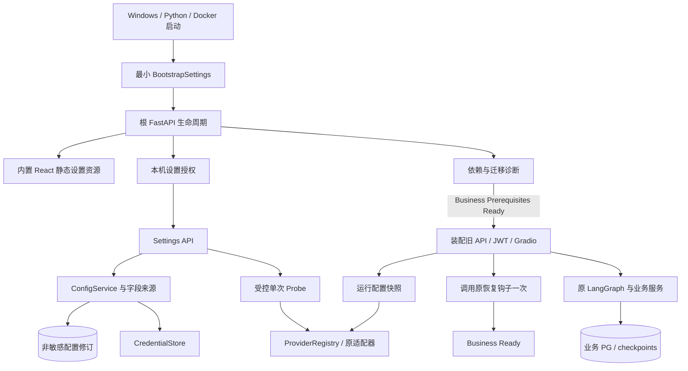

# Implementation Plan: Local Settings and Onboarding

**Branch**: `deepcode` | **Date**: 2026-10-10 | **Spec**: [spec.md](spec.md)
**Input**: 独立Feature；当前按 2026-10-19 用户授权收敛本地 MVP 验收。需求与验收以[spec.md](spec.md)为准，进度/任务证据以[tasks.md](tasks.md)为准。

## Summary

在现有单体中增加数据库外 ConfigService、CredentialStore、ProviderRegistry、ProbeService 与 Bootstrap 生命周期。分开 Setup Ready、Business Prerequisites Ready、Business Ready、逐任务 AI Ready；保留 FastAPI、LangGraph、业务 API、JWT/RBAC 和 Gradio。配置修订及运行快照承担一致性，不以重新初始化系统或重写 Workflow 达成目标。

## Technical Context

- **Language/Version**：沿用 Python >=3.12；新前端 TypeScript。当前 pyproject 只给部分依赖下限，实施用实际兼容锁定结果，不在本轮安装。
- **Primary Dependencies**：FastAPI、Pydantic Settings、SQLAlchemy、Alembic、LangGraph、现有 OpenAI SDK、Gradio；新增前端 React/Vite/Ant Design/React Router，构建期 TS 类型生成。Windows ctypes/DPAPI 无新 Python 密钥框架。
- **Storage**：PostgreSQL16/pgvector(1024)、Redis；配置非敏感 JSON、Windows DPAPI 密文或 Docker Secret 引用。
- **Testing**：既有 pytest unit/contract/integration、mypy、ruff；前端按 TCR 引入 Vitest/Testing Library 与浏览器验收，复用既有浏览器回执方法；不把这些依赖加入本轮仓库。
- **Target Platform**：Windows PC 浏览器、实际 PyInstaller onedir；Docker 开发/验证。Node 只参与构建。
- **Performance Goals**：Probe 上限见 NFR-004；设置不等待外部模型/数据库初始化。记录 Setup/Business 首次耗时，保留旧 EXE 计时起止点及实测数据，严格启动 SLO 改为 MVP 非阻断优化目标；功能和资源释放要求保持，见§9.1。
- **Constraints**：单后端、无新常驻服务，不改考试/评分语义，不删除 User/Role，不做自动索引重建，不把远端兼容标签当能力。
- **Scale/Scope**：单机、单后台配置写入者（进程文件锁拒绝第二写进程），多浏览器通过修订冲突协调；不设计集群配置广播。

## Constitution Check

| 原则 | 研究前 | 设计后/实施门禁 |
|---|---|---|
| I 可运行优先 | 保留三容器 | G5 同时证明设置可达及业务真实 ready；不把 HTTP 存活当核心业务成功 |
| II AI 能力优先 | v1.0 阶段目标已保留 | 本批设置解除 AI 使用障碍；没有全业务 UI 重构；措辞建议见§10.2 |
| III 模型可替换 | 复用 BaseLLMProvider | G3 通用 Adapter 和 Registry；业务不得导入供应商 SDK |
| IV 结构化输出 | 原合同保持 | G3/G6 JSON/Pydantic/Domain DTO；Probe 不豁免实际业务校验 |
| V 可评测 | 历史结果仅追溯 | G7 有配置/数据/Prompt/模型/失败记录，无效果承诺 |

未发现当前需要变更 Constitution 的强制冲突。若后续要改变恢复语义、模型维度或移除身份模型，先独立决策，不在实施时扩大本计划。

## Project Structure

文档职责：
- [spec.md](spec.md)：唯一需求与验收标准。
- [plan.md](plan.md)：技术架构、决策取舍及后续阶段；[research.md](research.md)只保留SpecKit固定研究入口和决策索引。
- [tasks.md](tasks.md)：唯一任务清单、状态及简短验收证据。
- [analysis-report.md](analysis-report.md)：当前问题、审查/阶段结论、B0和历史证据索引。
- [data-model.md](data-model.md)、两份[API](contracts/settings-api.md)/[运行](contracts/runtime-configuration.md)契约：结构、生命周期与协议的责任源。
- [quickstart.md](quickstart.md)：安全路径检查、资源计划及验证操作；[统一TCR](../../docs/test-change-record-local-settings.md)：每批具体测试变更与旧断言。
- [requirements](checklists/requirements.md)和[readiness](checklists/readiness.md)：内置及审阅者清单，保留原检查项/评价/标记。
- evidence/s0-b0-manifest.json为不可改写B0；_archive单个ZIP保留本轮整理前原始文档。

未来新增模块（目前不存在，不属于本轮改动）：

```text
backend/app/core/environment.py
backend/app/core/bootstrap.py
backend/app/core/settings_security.py
backend/app/services/settings/{config_service,credential_store,windows_credentials,
  mounted_secrets,provider_registry,probe_service,runtime_snapshot,readiness,index_identity}.py
backend/app/schemas/settings.py
backend/app/api/settings.py
backend/app/ai/llm/openai_compatible.py
backend/app/deployment/local_management.py
frontend/src/{app,api,features/onboarding,features/settings,features/diagnostics}/
frontend/src/api/generated.ts
tests/unit/settings/
tests/contract/test_settings_api.py
tests/integration/test_settings_lifecycle.py
```

既有责任边界需未来定点调整：core/config.py/app.py/security.py/database.py/redis.py；各 Provider 工厂；api/workflow.py/grading.py/question_generation.py；ai/workflows/state.py/grading_workflow.py；文件/备份服务；部署 launcher/editor；测试 helper、benchmark 入口、Dockerfile/Compose/PyInstaller。新增数据库元数据仅用于索引身份（KnowledgeBase 的可空 JSONB 登记，见 data-model）；迁移文件名在实施时依实际 head 分配，不能预造与并行开发冲突的 revision。

## 1. 当前与目标架构

当前实现差距及源码证据见[analysis-report.md §实现差距](analysis-report.md#implementation-gaps)；下图是目标设计，不是实现完成声明。



不设置第二个业务事实源。ConfigService 管配置，业务服务管课程/成绩，已有 PG 检查点管 Workflow 状态。根应用统一关闭引擎、客户端及管理任务。

## 2. 配置来源与激活

### 2.1 引导身份

启动参数只接受环境、配置根和端口；优先级：显式 CLI 环境 > EDUAGENT_ENVIRONMENT > Windows/Python 默认 development、Docker 默认 demo。test 必须显式；环境/根目录一旦选定不能网页热切换。DEV_MODE 保留为独立且默认 false 的旧快捷登录开关。

配置按三层类型拆分：BootstrapSettings（环境、路径、绑定、静态资源）、BusinessSettings（数据库、Redis、JWT/存储）、Provider 配置。旧 AppSettings 兼容入口经过单一解析器投影；不能向其必填字段填假 Key 让 Bootstrap 通过。旧业务消费者按需要取得配置段，模型只在 AI 调用边界解析。

### 2.2 明确优先级

非敏感字段从低到高：内置合法默认值 < 环境内已保存有效修订 < 显式指定的开发/CI 非敏感 dotenv < 当前进程环境变量。Windows 普通启动不隐式读取仓库或当前目录 .env；Docker 的配置只读挂载在“已保存配置”槽，环境变量照常覆盖。全部入口共用解析器，替代旧 EXE “文件覆盖进程环境”。

秘密不是同一个 merge 字段：Windows 默认解析 DPAPI 引用；Docker 解析允许列表中的 Secret 引用。development/test 可显式启用仅进程生命周期的 secret env 覆盖，用于 CI；不从新 dotenv 持久读取秘密，不将 env 值写入保存文件。UI 返回来源和 secret 状态，不返回覆盖原文。生产者提供字段来源，前端不猜。秘密的process_env覆盖仅在当前进程有效，重启后原运行的该秘密引用为不可用，不自动关联新的同名环境变量。

保存被 env 覆盖的字段必须带 acknowledge_override=true；只更新保存值，响应明确 effective=false，不能声称已生效。非法 env 覆盖阻止该段就绪，不能用旧值/默认值隐瞒。

### 2.3 保存、检测、激活分离

用户保存非敏感 draft → 校验 Schema/能力/路径 → 凭据新修订安全写入 → 显式检测 → 用户激活。未配置 AI 可保留草稿或仅激活业务设置；不能将未测候选标成已验证。

ConfigService 在同文件系统写临时文件、flush 后原子替换修订/manifest，进程文件锁及 expected_revision 防覆盖。新凭据先写，最后切 active 指针；崩溃后孤立密文只登记可清理，不自动删运行引用。写失败保留上一指针并报告原始阶段的安全错误码。配置损坏/未来 schema 不自动改写；进入 Setup，展示最近有效修订供用户显式恢复。备份和回退不会偷偷生效。

激活条件：本地 schema/能力成立；新增、启用或变更的 AI 绑定，其必需能力须引用同候选/Profile/凭据版本且成功后10分钟内的 Probe。禁用/暂不使用的能力无需测试；完全未变的已激活绑定沿用其 activation_validation，不因保存无关业务字段要求重新付费。未经验证的新候选只保存草稿。

10分钟仅是接纳候选的证据新鲜度窗口。激活时将对应能力、不可变绑定/凭据版本、probe_id、tested_at、accepted_at 写入该修订的 activation_validation；它不是10分钟租约。已激活配置、在途快照以及已接纳的 pending_restart 不因 Probe 过期失效；重启只重查本地引用/依赖及配置一致性，不暗中再次付费。变更目标身份或凭据版本须新 Probe，单纯等待、打开页面、轮询、普通重启均不触发模型检测。外部服务后续失败按当前操作真实错误处理，成功检测不承诺持续在线。

### 2.4 热更新表

| 项 | 行为 |
|---|---|
| 草稿、UI向导进度 | 保存即持久，不改变业务运行 |
| LLM/出题/阅卷/LLM重排绑定、阈值和检索策略 | 激活后只影响新运行；旧运行固定快照 |
| Embedding 语义配置 | 先索引兼容检查；本批需受控重启激活，旧索引未知时不直接切换 |
| 本地 OCR/BGE/CrossEncoder 资源 | 检测资源后待重启；无隐式下载 |
| DB/Redis/存储根/JWT/端口/环境 | 待重启；不搬数据，不在原进程换引擎或身份 |

进行中的写任务未排空时不执行重启，30 秒停止等待后保持 pending_restart 并返回 busy，不强杀。暂停 Workflow 可跨重启，但原配置/凭据仍保留。旧无快照非终态运行规则见§6/§10 R08；限制只针对影响它的激活。

## 3. 安全凭据和授权

Windows CredentialStore=`put/get/delete/status`，DPAPI CurrentUser，密文目录只授当前用户与系统所需访问，不写安装目录、Git、临时目录或业务备份。所有秘密（Provider Key、DB/Redis 密码、JWT）使用同一边界；URL 拆为非敏感定位与 password_ref，禁在 URL userinfo/query 塞 API Key。

替换生成 credential revision，成功检测和激活后更换引用；旧运行引用继续可用。删除有显式意图，存在 active/pending/nonterminal snapshot 引用返回 409 IN_USE；先完成任务和解除绑定，再删除。已完成历史只保留“曾使用该引用”的元数据，不要求永远保留秘密。显式作废会降低对应 AI Ready，不将保留的失效秘密视作成功。

Docker 外部 Secret 只读，非敏感 profile 通过允许的 secret_id 绑定；不能接受任意本机路径。外部版本必须不可变：轮换挂新名称/版本，旧运行未结束前保留旧挂载；原路径被覆盖或丢失导致原运行 CREDENTIAL_UNAVAILABLE，不改用新值。运行期可用已打开的内存秘密，但重启后无法证明旧版本则阻止恢复。Secret 版本标识用于凭据生命周期，不是源码哈希门禁。

Bootstrap 权限详见 contracts/settings-api。Windows launcher 生成单次32随机字节授权码，管道传给后端；浏览器 fragment 转交 exchange 后立即清地址和内存。5分钟过期且只能消费一次。换取设置 token 存前端内存，闲置10分钟/绝对30分钟过期；刷新/关闭重开按下述持续入口重新授权。 token不入日志、argv、查询串、localStorage/sessionStorage。所有管理API验token+环境+进程+精确Host；安全GET/HEAD缺Origin可接受但不免Token，提供Origin则精确匹配；敏感操作（含exchange）必须合法Origin，按settings-api §1.2拒绝缺失/null/非法值。公开 GET 仅静态资源及粗粒度状态。

Windows持续入口：沿用现有 Launcher 所有者进程，保留一个最小控制窗口，提供“打开设置/重新授权”和“退出”；不恢复旧明文配置编辑器、不新增后台服务。当前 stdin 在 SERVE 后关闭，T221须改为存续于自有worker生命周期的匿名控制管道并提供注册确认；新码只由Launcher生成并通过该受控通道登记，确认后才打开带fragment的设置页，不能写stdout日志。新发码作废该启动器先前未兑换码；已兑换的其他页面会话仍按各自期限到期，支持既定双窗口冲突场景。

授权码过期/已使用、刷新丢失token、关闭浏览器后重开或会话闲置/绝对超时，页面均进入“需要重新授权”，清掉秘密输入并指导用户返回仍在任务栏的Launcher点击上述按钮。新页面换码后GET已保存草稿/进度；未保存输入不承诺恢复，绝不自动重放Probe/迁移。关闭浏览器不停止Launcher；退出Launcher走原自有worker停止规则，正常重启应用后用新实例授权。重复双击EXE若端口/配置根已被占用，提示回到原Launcher，不接管未知实例、不在公共API领码；管道丢失提示受控退出再启动，不能杀死无关进程。

源码启动使用同一 local_management helper及其仍在运行的本机控制入口；Docker 宿主操作员通过受限 exec 管理命令申请一次授权码，在当前终端交互显示，禁止进入容器服务日志；不开放 HTTP 领码端点。Docker 127.0.0.1 发布验证加 token/Origin，不因容器 peer 非 loopback 放弃权限检查。业务 API 继续旧 JWT/RBAC，设置 token 无业务权限；同 OS 用户信任边界明确。

## 4. Provider 与 AI Ready

Registry 唯一生成 UI preset、能力、参数 schema、factory 映射及 Probe 类型，不另维护“支持名称”清单。保留 generate_structured 的原必需参数/返回合同，新能力元数据默认保守 false/unknown，不强制旧 Stub 实现新增抽象方法。

| Binding | 有效解析与依赖 |
|---|---|
| default_llm | 显式选定文本结构化 Profile |
| question_generation / subjective_grading | 可覆盖，否则 default_llm；若实际选 RAG，合并 Embedding/Rerank 就绪 |
| diagnosis / content_validation / paper_extraction | 明确继承 default_llm；当前不再增加三个高级表单 |
| reviewer | rule_based，模型不适用；不得无故调用默认 LLM |
| embedding | 独立配置，绝不自动拿 LLM Key/Model；含索引兼容约束 |
| rerank | llm 可沿用默认 LLM 或绑定专用 Profile；cross_encoder 本地；none 只对不含重排的检索模式合法 |
| vision | 独立 Profile/模型，能力必须支持 image + structured；DeepSeek 原路径保留，通用 Adapter 只在明确实现和 Probe 后可用 |
| ocr | enabled/provider/model/resource_dir；本批只内置现有 RapidOCR 预设，扩展 Provider 不因字段可写自动实现 |

通用 OpenAI-compatible Adapter 最小支持文本 JSON 模式+本地 Pydantic；可声明 json_schema 或 vision，但仅实现其传输/校验合同后列入可选能力。本批不实现所有厂商 SDK或独立云 /rerank。

AI Ready 按任务由有效绑定、真实能力、可用凭据/本地资源、已接纳的 activation_validation 和该任务实际依赖计算。报告 last_probe 与 activation_validation，另列已观察到的 last_runtime_result，不把它们混成一个过期布尔值。新候选未验证为 unverified；已激活且依赖仍满足的绑定，即使 last_probe 超过10分钟仍保持 ready。配置失效、能力不匹配、凭据明确失效或依赖不可用才阻止相关操作；暂时网络失败按当前请求报告，不承诺持续在线、不自动付费重测，后续由用户发起的正常业务请求仍可尝试。OCR disabled 为 not_required；规则 Reviewer 为 ready_rule_based。AI状态不得用于全局Business装配门槛，任务入口按快照检查真实依赖。

## 5. Bootstrap 生命周期与初始化

### 5.1 四层状态和无环关系

| 状态 | 判定条件 | 不包含 |
|---|---|---|
| Setup Ready | 静态资源、最小配置读取/诊断及设置授权服务可运行；配置损坏可被安全报告而无需覆盖原文件 | DB、Redis、业务JWT、任何模型在线 |
| Business Prerequisites Ready | 本进程有效Business配置/JWT引用、PG连通、vector扩展、允许的迁移head及必要表列、Redis、持久目录均通过 | 业务路由是否已装配、恢复钩子结果、AI Probe |
| Business Ready | Business Prerequisites Ready + 旧业务路由/鉴权/Gradio装配成功 + 本进程原恢复钩子启动阶段已完成 | 所有AI可用、已有业务账号、所有旧任务可自动恢复 |
| AI Ready | 按任务的配置、能力、凭据/资源、激活接纳证据和实际依赖；见§4 | 无关任务状态、Probe到期倒计时 |

方向固定为：前置依赖检查 → 装配 → 原恢复阶段 → Business Ready。绝不以Business Ready作为装配输入。尚未装配或任一启动阶段失败时，根设置应用保持运行，业务入口503；不存在通过设置请求临时热挂路由的路径。

### 5.2 启动、初始化、重启和恢复

1. 最小引导段建立根应用与设置资源。业务模块改为条件导入，不能为通过工厂校验填假Key/连接。启动检查有短超时，不等待模型、安装服务或自动执行迁移；检查失败仍完成根应用启动。
2. 在本进程启动阶段读取已接纳配置并检查 Business Prerequisites。通过后仅装配一次原/api、原JWT/RBAC和/gradio；失败记录安全原因并留在Setup。根生命周期明确调用原业务启动/关闭逻辑，不能依赖mount隐式运行子应用lifespan。
3. 装配完成后依原顺序调用 recover_interrupted_grading_tasks、recover_diagnosis_pending_runs、recover_interrupted_paper_imports，各在该业务进程启动阶段调用一次。沿用“中断任务标记/诊断待恢复”等语义，不自动重放模型调用、不新增恢复队列。尚未装配时不调用；单次请求、健康轮询和诊断均不再次调用。未预期异常或依赖失效导致启动阶段未完成时，Business Ready=false并保留原因；旧函数允许的逐运行跳过仍须可解释，不据此声称该运行已恢复。
4. 授权诊断分项检查PG/vector/migration/schema/Redis/目录（文件仅创建并清理本次探针）。初始化预览展示环境、目标、current_head/target_head；用户确认后仅执行已审查的非破坏性迁移。未知结构/破坏性路径需独立审查，已有库不自动清空。它不等于依赖安装，也不负责账号创建。
5. 首次缺JWT时Windows安全生成保存，Docker要求外部Secret；旧账号仍沿原受控流程建立。只保存草稿/向导进度无需重启。若本进程启动时未装配业务，补齐依赖或完成初始化后必须重启，即使诊断已显示前置条件通过；此时 business.assembly=not_mounted、Business Ready=false、restart_required=true。pending配置的候选诊断与运行中effective配置分开，不将候选成功冒充当前就绪。
6. Windows由Launcher受控排空并重启自有worker，忙时保留pending并拒绝强杀；Python/Docker给手工重启指引。新进程重新检查前置条件、装配并调用恢复钩子一次，成功才Business Ready。初始化API和/ready不直接调用恢复钩子。
7. 已装配进程中临时PG/Redis故障使Business Ready降为false，恢复后依赖重检可重新ready，不重复装配/恢复。若改变DB/Redis/存储/JWT等配置，仍须按§2.4重启。AI缺失只阻止依赖该能力的业务操作；无AI的原授权业务保持可用。

### 5.3 HTTP语义

/health只表示进程存活；/setup-ready表示Setup Ready；/ready仅Business Ready，未装配/恢复阶段未完成/依赖失效均503。三个公共端点仅安全概览，不执行迁移、授权、付费Probe或Workflow恢复；详细检查来源与逐AI状态见授权/api/settings/readiness。
Compose healthcheck仍用/ready，Bootstrap期间unhealthy但服务保留，不以健康重启循环杀向导；backend启动HTTP不等待DB/Redis容器healthy。

首次可见增量见tasks的E1：T218只接根应用，T219提供前置诊断；E1未接入凭据后端时只报告credential_backend_unavailable/not_evaluated，不把已有秘密误报失效、不尝试匿名回退连接；完整凭据解析与相应认证连接诊断在T220汇合；业务装配及恢复协调接线由T220在T215业务保护通过后完成。E1本身不宣称Business Ready、完整向导或可发布。

## 6. 运行快照与历史兼容

运行快照包含有效非敏感配置、绑定 Profile 修订、credential_ref/version、请求模型、Prompt/Schema 版本、检索/阈值、索引身份；从最早应用服务调用创建并传至全部消费者，不能由下游重新 get_settings。配置服务按 snapshot 管客户端释放，不在全局缓存中替换原实例。恢复直接读取已保存的有效值，不重新叠加当前环境变量、默认值或当前任务绑定。process_env 秘密引用只属于原进程实例，跨进程不可自动重绑定；需要可恢复真实运行时使用持久凭据后端。

快照持久于配置环境的 config/snapshots；Workflow 状态/检查点增加 snapshot_id 及必要来源字段并升级 payload version，支持读取原版本。现有 WorkflowRun.checkpoint（JSON）与 LangGraph 持久检查点是运行事实源，不新增并行状态表。普通出题/阅卷结果沿现有 metadata 记录实际调用模型与 prompt，并引用 snapshot_id。备份将被非终态运行引用的非敏感快照纳入一致备份集，秘密不进备份。

旧 Workflow 缺 snapshot 明示 legacy_unknown；接纳时冻结当前 legacy baseline，存在旧非终态运行时拒绝相关模型/策略激活，继续原恢复合同，历史来源不回填。新运行一律完整快照；升级前即无法恢复的问题不能被本批虚报解决。

索引身份保存在 KnowledgeBase 新的可空 embedding_identity JSONB（登记事实，不改 vector 维度）。新库首次摄取原子登记 provider/model/version/dimension/语义参数；每次查询和摄取检查兼容身份。旧有向量为 unknown：保留既有配置读取模式并标未验证，阻止更换；只有操作者提供原部署/benchmark来源证据并显式接纳为兼容基线后允许继续新增摄取，不把该记录伪造成旧向量生成时间。受控接纳由设置中心“索引兼容性”进入：先查看KB标识、实际维度及旧身份unknown，再提交脱敏原部署/摄取/评测证据，预览可接纳身份和冲突，确认后原子保存legacy_adopted及审计事实。不能拿当前配置或一次新Probe当历史证据。API、证据字段和并发规则分别见settings-api §6、data-model §7；T214实现服务，T220接API，T228接UI，T211/T238验证。维度/语义不兼容需要独立重建 Feature；本批不实现重建。

## 7. Development / Test / Demo

| 资源 | Development | Test | Demo |
|---|---|---|---|
| PG | 显式接纳旧业务DB | 专属 eduagent_test DB/角色；每运行随机schema；备份测试专属测试实例 | 独立 eduagent_demo DB/角色 |
| Redis | dev实例 | 独立实例，key含环境+run_id | demo实例 |
| Windows数据根 | %LOCALAPPDATA%/EduAgent/development | %LOCALAPPDATA%/EduAgent/test/runs/run_id | %LOCALAPPDATA%/EduAgent/demo |
| Docker | eduagent-dev 项目 | 独立 Test 项目、网络、卷与已核验可用的 loopback 端口；历史 M0 名称不强制 | eduagent-demo 项目 |
| 文件/日志/缓存/temp | 根内分目录 | run专有目录 | demo根内分目录 |
| 配置/秘密 | 环境独立 | Fake/隔离测试秘密 | 独立Secret或DPAPI |
| 评测输出 | 环境results/run_id | test/results/run_id | demo/results/run_id |

旧 storage 和DB不会因默认目录变更而移动或变空：首次接纳须预览旧资源位置并记录引用，禁止把正在用的旧库配上空新storage。路径含环境及实际目标身份；每次测试前由连接读取 current_database/user/schema，与 Test 资源计划匹配；凭 test 字符串前缀不足以授权删除。

文件清理只处理本次manifest列出的已解析绝对路径，拒绝根目录/父路径、重解析点逃逸与其他环境。数据库清理使用本次创建返回的schema/库所有权，禁public/业务schema；禁Redis FLUSHALL和共享卷 down -v。Test角色不能写dev/demo库。端口必须独占且归属明确；不因更换测试项目名而接管已有监听或卷。

T199 的 Test 预检使用显式 `EDUAGENT_ENVIRONMENT=test` 和外置非敏感 `EDUAGENT_TEST_RESOURCE_PROFILE`（environment_id、Test库/角色/host/port、服务端 system_identifier、独立 root、可选维护身份）；测试 URL 连接前须与 profile 一致，连接后读取 `current_database`、`current_user`、`current_schema` 和 `pg_control_system().system_identifier` 复核。schema 以本次 run_id 命名，创建后查询 owner 再记收据，清理前再次查实际身份及 owner。备份建库另需同一专属 Test 实例的非 superuser、具 CREATEDB 权限的维护身份和显式 `EDUAGENT_TEST_MAINTENANCE_URL`；Test runner 不承担建库权限。构建/启动前仍须有 Test profile、独立环境文件、显式绝对 Compose 文件、禁用隐式 `.env` 并核对解析后的项目/端口/卷，不能只相信环境变量。历史固定 M0 入口保持原护栏且不强跑；当前 MVP 允许独立同构 Test 的等价验收，见§9.1。quickstart §0.3 保留历史身份，不能授权接管；Fake 用例通过不代替容器级验收。

## 8. UI、API 与交付

React路由：/setup、/settings、/diagnostics；默认入口根据 setup 状态导航。生产以FastAPI同源提供已构建资源，设置API路由不得被SPA fallback吞掉。开发Vite代理到本机后端，精确允许该开发Origin；生产不开放开发Origin。无ServiceWorker缓存配置/密钥；秘密仅输入内存，提交后清空。

后端 OpenAPI 为 DTO 事实源，类型生成不需加载业务DB或真实模型；构建验证返回字段绝不包含secret value。不会将领域服务搬至前端。进入 /gradio 明确旧登录；不在本批共享或复制 JWT 到新长期浏览器存储。

Windows沿用onedir、worker所有权、外置持久目录；拆除Tk旧明文编辑路径的默认入口，保留经用户明确选择的旧配置导入功能；失效时显示安全诊断而非退回明文编辑器。Docker多阶段构建产前端资源并拷入后端，不增加第四服务；配置volume/secret引用按环境挂载。构建回执记录依赖/源码用于追溯，不制造相等版本门禁。

## 9. 回退、风险与验收门禁

| Gate | 条件 | 失败处理 |
|---|---|---|
| G0 范围与基线 | quickstart §0.1活动路径只读核对、保护旧任务/未提交修改、三层基线、具体TCR及产品决定 | 仅暂停受影响变更 |
| G1 隔离/持久 | 三环境及跨环境拒绝、原子保存/来源/损坏恢复 | 拒绝写入；保留原配置/资源 |
| G2 秘密与权限 | DPAPI/Secret、无泄露、未授权/跨源/过期拒绝 | 设置可诊断，不降级明文 |
| G3 Provider | Registry真实能力、八类Probe、费用/取消/释放 | 候选保留草稿，原active不变 |
| G4 Bootstrap | 无DB/Key设置可达，ready不虚报，迁移/重启有目标与所有权 | 保持Setup并显示原失败 |
| G5 双交付UI | 真实EXE和Docker静态资源、浏览器、持久化/退出 | 不以源码运行代替发布验收 |
| G6 业务保护 | 快照跨重启、索引兼容、审核/最终化/客观评分/RBAC回归 | 禁止模型激活，保留旧语义 |
| G7 质量与证据 | 既有pytest/mypy/ruff、前端构建/类型、相关契约/集成、显式real记录 | 记录真实fail/skip/not_run，无伪成功 |

回退对象是配置修订和应用包，不自动downgrade用户数据库。新增可空索引身份字段保持旧代码读取兼容；旧包不理解安全存储，故不能承诺直接回退旧明文启动器可用。回退时保留v3安全引导/经评审的兼容包，或在隔离副本人工恢复已保留旧部署；不得导出新密钥成明文。跨版本恢复前核对schema/checkpoint兼容，未获批准不自动破坏性迁移。

主要风险为旧入口隐藏 get_settings、旧全局缓存、缺历史模型身份、打包生命周期以及Docker授权经NAT差异；均有具体任务和验证。纯净机依赖安装和未来无登录迁移不作为本批阻断项。

<a id="mvp-acceptance"></a>
### 9.1 本地 MVP 验收调整（2026-10-19 用户决定）

本节只调整当前 Feature 的交付门禁，不改写旧 Feature、历史测量或测试断言。目标是 Windows/Docker 可运行、首次配置完整、真实 AI 最小业务及数据可安全恢复；并非企业生产级认证。

| 原要求 | 当前 MVP 要求与原因 | 保留状态 |
|---|---|---|
| 启动逐次满足首次 <30 秒/后续 <10 秒 | 时间作为非阻断优化目标；保留真实 EXE 入口到业务 ready 且页面渲染的计时，Setup/人工配置/安装分开记录。约 1–2 秒超标不触发架构重构；卡死、不可用、泄漏仍阻断 | 严格 SLO deferred；超标记录不变 |
| 跨用户 DPAPI 动态隔离 | 单用户本地 MVP 保留 CurrentUser、ACL、同用户重启和损坏/重录保护；不为补证创建账户或提权 | 跨用户动态测试 deferred / not_run |
| 三次完整首次启动 | 至少一次独立干净配置闭环；真实页面交互、配置/迁移/激活、受控重启、业务入口、正常退出不可省略。既有五次后续启动仅覆盖后续启动 | 额外首启重复 deferred；首次闭环仍必验 |
| 固定 M0 项目/端口/旧卷 | 名称不是业务行为；采用独立同构 Test 及下述等价断言，不接管历史资源 | 原固定入口 not_run；不冒称执行成功 |
| T238 依赖整项 T234 | 改为依赖已验证的实际包兼容、同用户凭据恢复及数据保护；启动速度、跨用户矩阵和首启重复不影响升级回退正确性 | 依赖范围调整，不豁免恢复用例 |

M0 的必要业务含义保留：真实镜像/三服务、PostgreSQL 与 Redis 可用、已审查迁移到当前 head、业务恢复完成后的真实 /ready、持久化及隔离清理。可组合复用 T235 的真实 Compose 生命周期、真实 Test PG 的初始化/head/幂等测试、Bootstrap HTTP 契约和原 M0 隔离护栏单元测试；必须逐项说明覆盖，不能把组合批次称为一次固定 M0 实跑。T235 不验证旧 smoke 脚本本身的部署顺序；该脚本及固定入口作为旧路径保留，不再是 MVP 唯一交付入口。若仍有未覆盖的必要断言，在新建且核验身份的 Test 资源补齐。

T238 的 Schema 回退沿现有非破坏性合同：0024 身份列保留、旧兼容代码可读、重新升级幂等；不要求删除身份审计列或自动 downgrade 用户数据库。Workflow Snapshot、历史向量/身份、引用与密文、配置修订恢复、失败闭锁和原副本完整性均保持。

T239 按 G0–G7 的 MVP 适用范围复核：双交付可用、首次设置闭环、前后端与旧业务协作、真实 Provider 最小业务、评分/人工复核语义、配置/凭据/快照/索引、备份恢复、必要自动化与静态质量。真实 Provider 无授权仍 not_run；首次闭环或真实业务缺证时 T239 不完成。额外企业安全矩阵及重复性能强化 deferred，不宣称已验证；Setup Token、Host/Origin、凭据与数据安全门禁不变。

## Complexity Tracking

无需要豁免的宪章违规。配置文件库解决DB自举，凭据服务解决持久秘密，运行快照解决暂停恢复，最小React由用户确认；不增加远程配置中心、通用插件运行时、独立Worker或统一重写所有AI逻辑。

<a id="technical-decisions"></a>
## 10. 已批准技术决策与取舍

日期2026-10-10；R01–R09承接原研究编号，均为设计结论，实施/运行验证尚未完成。技术选型、生命周期和错误合同以本计划、data-model及contracts为准；索引research.md不维护第二套规则。

| ID | Decision / 理由 | 替代方案与代价 | 详细条款/来源 |
|---|---|---|---|
| R01 | 保留Pydantic，数据库外薄ConfigService+EnvironmentProfile+不可变SettingsRevision；DB未配时也能设置，统一来源/激活 | PG配置表造成自举依赖；继续改.env不满足秘密持久保护；远程配置中心超出单机范围 | §2；[Pydantic sources](https://docs.pydantic.dev/latest/concepts/pydantic_settings/)；优先级是本项目设计，非默认已实现 |
| R02 | Windows用CurrentUser DPAPI，标准库ctypes/Crypt32，环境隔离密文；不新增pywin32/keyring | Credential Manager Generic Credential可行，OS管理便利但需同步外部删除且blob上限2560字节；本批无需通用后端 | §3/下面生命周期边界；[CryptProtectData](https://learn.microsoft.com/en-us/windows/win32/api/dpapi/nf-dpapi-cryptprotectdata)、[CREDENTIALW](https://learn.microsoft.com/en-us/windows/win32/api/wincred/ns-wincred-credentialw)、[CredWriteW](https://learn.microsoft.com/en-us/windows/win32/api/wincred/nf-wincred-credwritew) |
| R03 | 用户已选Docker外部只读Secret；UI保存引用/状态，不写密钥 | 加密volume+主密钥可支持GUI写入，但增加关键依赖、备份/恢复责任，已排除 | §3；[Compose secrets](https://docs.docker.com/compose/how-tos/use-secrets/)、[service secrets](https://docs.docker.com/reference/compose-file/services/#secrets) |
| R04 | 用户已选最小React+TS+Vite+AntD+Router；hooks/context局部状态、原生fetch取消/错误、拟openapi-typescript构建类型 | Gradio少一条构建链，但未来设置需重写；React增加双UI、构建/静态打包与路由回退验证，换取后续外壳/API复用；少量配置页不加全局状态/查询缓存库 | §8；[Vite build](https://vite.dev/guide/build.html)；Node仅构建，无新运行时服务 |
| R05 | 根FastAPI先Setup，Business Prerequisites→装配router/Gradio→原三恢复钩子一次→Business Ready；重启激活依赖/目录 | 假Key/空连接制造假就绪；第二后端端口增加授权/UI/打包复杂度；不重写Workflow | §5；[FastAPI lifespan](https://fastapi.tiangolo.com/advanced/events/)；根统一资源生命周期，不假定子应用lifespan自动执行 |
| R06 | 本机OS用户/宿主管理者一次码换短期内存Token，复用Launcher持续入口；旧业务JWT/RBAC保留 | DB鉴权不能承担自举；公开GET不能领码；无浏览器持久Token或新增后台服务；不解决同OS用户间保密 | §3、settings-api §1；[Origin header](https://fetch.spec.whatwg.org/#origin-header)、[Docker publishing](https://docs.docker.com/engine/network/port-publishing/)；Docker NAT peer不等同loopback |
| R07 | 统一实际Registry，能力分别声明/检测，通用文本Adapter新增；Reviewer为规则，Rerank别名为LLM重排 | 供应商名/白名单/工厂构造不能证明能力；Probe不得套业务retry/fallback掩盖次数；候选10分钟只约束接纳，active不定时收费 | §4/§2.3；[DeepSeek JSON Output](https://api-docs.deepseek.com/guides/json_mode/)仍需提示与本地schema，空输出保留失败；真实Vision未验证 |
| R08 | 非敏感RuntimeSnapshot贯穿运行/恢复；vector仍1024，按语义身份核验，unknown仅历史证据接纳 | 清全局缓存影响在途实例；恢复取当前配置会混模型；只比较维度漏掉不同空间；不新增Prefix Cache/自动重建 | §6及两份契约；旧非终态无快照期间冻结相关激活，原Prompt/Adapter/凭据缺失明确阻塞，不能回填历史 |
| R09 | Dev/Test/Demo独立目标，Test库/角色/Redis+每run schema/目录；默认Fake，真实调用显式选择/费用授权 | 随机schema不是权限隔离；原benchmark默认策略不一致须先TCR后改；Development接纳旧资源不搬迁 | §7及[quickstart §0.3](quickstart.md#resource-plan)；实际资源仍pending |

### 10.1 凭据实现边界

DPAPI必须正确声明ABI/长度，使用UI_FORBIDDEN、不用LOCAL_MACHINE，LocalFree释放输出；明文仅调用期存在，Python不承诺所有字符串可靠清零。[DPAPI示例](https://learn.microsoft.com/en-us/windows/win32/seccrypto/example-c-program-using-cryptprotectdata)、[ctypes](https://docs.python.org/3.12/library/ctypes.html)为实现依据。
密文损坏、用户配置丢失或密码管理重置时明确重录；不承诺跨机器/用户移植，不防御同OS账号恶意进程，无明文fallback。
Compose Secret是外部服务挂载，不等于Swarm加密仓库；宿主文件权限由宿主管理，不能凭uid/gid/mode声明认定bind source已隔离。不向网页挂Docker socket管理宿主秘密。

### 10.2 宪章解释与未验证项

I保留三容器和真实业务就绪；III可替换Provider；IV JSON/Pydantic；V真实效果须证据。II的第一阶段80%/20%依原规格指v1.0，不量化为当前设置批次工时比例；当前范围由D06–D08确认，服务AI使用，不扩展全业务UI。没有必须修改宪章的冲突。
原研究建议可另获批准澄清“第一阶段专指v1.0，后续按已批准阶段目标，保留AI优先和最小基础设施”；本轮未改宪章，该建议不作新增门禁。未来取消JWT/全React需变更局部业务合同，但非宪章永久绑定技术。

DPAPI ABI/冻结包、Docker NAT/挂载权限、通用服务能力、全量回归、纯净机和UI均待S1–S5真实取证；版本仅追溯，实施锁定实际兼容依赖，不自动追新或换路线。

<a id="future-roadmap"></a>
## 11. 后续v3.0阶段与退役条件

D01–D08为已确认方向，当前仅本Feature有实施级tasks；Python/FastAPI/LangGraph保留，Rust不进入路线。路线不授权后续Feature、迁移、清理、提交或发布。

| 阶段 | 交付边界 | 前置与退出条件 |
|---|---|---|
| V3-A 环境隔离与本地配置 | 当前Feature的S0–S2：环境身份、隔离、来源、凭据、Provider、运行快照与索引保护 | 先TCR和Test安全目标；不删除旧数据，不纳入Prefix Cache |
| V3-B 初始化与设置中心 | 当前Feature的S3–S5：Bootstrap、React设置、诊断、双交付及业务回归 | 基础隔离后可先交付E1外壳/诊断；完整向导与业务装配仍汇合A的保护能力，再做真实包/容器验证 |
| V3-C 无登录模式与StudentProfile | 本地教师/学生切换、多个学生档案及身份/归属新合同 | 先盘点User/Role/JWT/Admin全部生产者/消费者、FK、审计和备份；迁移/恢复/权限边界由用户独立批准，不能直接删表 |
| V3-D PC工作台信息架构 | 重新分区：教师资料与题库、考试与阅卷、分析；学生考试、结果与学习 | 先明确无登录/档案语义；允许先做只读原型，不能机械复制Gradio或将原型视作合同 |
| V3-E React分业务迁移 | 在已交付外壳上逐功能迁移教师/学生工作台 | 每个业务分区API、状态、权限及验收等价；Gradio页面逐项验证后退役，不能一次删除 |
| V3-F Windows最终交付 | 全PC流程、持久目录、离线静态资源、清晰依赖准备、升级/恢复 | C–E完成；纯净机、实际包、历史数据恢复/安装升级真实证据；是否提供数据库一体安装器另作成本与维护决策 |

阶段调度：A与B早期E1（T218/T219/T221/T222）可交错；A保护能力完成后才完成B及进入C；D可在C合同设计期间形成信息架构，正式实现依赖确认的档案/权限合同；E按业务逐片交付；F最终整体验收。Docker开发/验证贯穿各阶段，后续UI/身份工程不阻断当前配置中心。

### 11.1 退役边界

旧JWT/RBAC和User/Role在C独立迁移与恢复验收通过前保留；旧Gradio在E相应页面等价验收前保留。业务审核、客观规则评分、结构化结果、人工复核与最终成绩约束持续有效，不随技术栈退役。

v3取消登录不表示本机设置无操作权限，也不表示模式切换能隔离同一OS用户。是否要学生防篡改、共享PC隔离、局域网访问是未来显式需求，不擅自加入本批。

<a id="document-maintenance"></a>
## 12. 文档维护约束

测试结果、验收记录、失败分析和阶段总结仅在当前 Codex 对话汇报，不写 Markdown 或替代 TXT/JSON 报告。测试、构建及工具必需的机器产物可以正常生成；既有基线与安全证据不篡改。
每个 Task 只更新 tasks.md 状态及必要的简短证据；设计变化更新既有 plan、data-model 或契约。analysis-report.md 仅保留必要架构分析。测试源码变更前，在统一 TCR 简要注明原因、受影响断言及变更边界，不追加执行统计。
旧 Feature 指针按 quickstart §0.1 只读覆盖解析；研究入口、规格、契约及评审者维护的 Checklist 保留。新增文档仅限明确需要的设计/契约或用户请求，普通任务不另建计划或验收报告。
