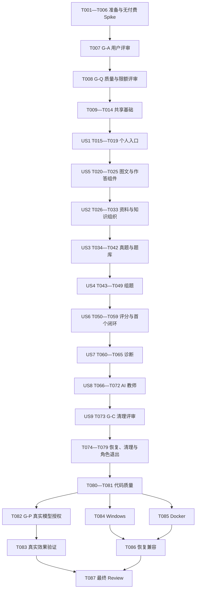

# Tasks: EduAgent 个人自主学习

**Input**: [spec.md](spec.md)、[plan.md](plan.md)、[research.md](research.md)、[data-model.md](data-model.md)、三份 [契约](contracts/personal-learning-api.md) 与 [quickstart.md](quickstart.md)。
**Status（2026-10-23）**: T001–T087均已勾选（87/87）。2026-10-23用户明确批准T083、T084、T085、T087按“先验收、先使用、发现问题再优化”的带边界口径勾选，T086保持已勾选；勾选不等于全部pass。4条历史outcome_unknown保留，完整浏览器闭环未完整验证，DOCX两平台未重测，详见下列已知边界。G1既有真实样例仍有oracle_pass=false（ANSWER_ENCODING_INVALID等），不因勾选改记为pass。账本记录末值recorded=39/40、proven=32/35、disputed=6、A3=6/10、A4=9/10；本轮真实发送0，无commit/push/正式发布。
**Post-MVP**: 6/6（T088–T093 完成；与上方 87/87 分开计数，不改变 V1 验收结论）。T088–T092 为 M1，T093 为 M2 三屏 QuickStart；M2 已完成真实浏览器空环境与已有数据闭环。

**Tests**: 用户明确要求可测试任务与独立高风险验收。未来新增/修改测试先按 T001 留最低必要 TCR；详细结果只输出会话，不创建验收报告。
**Organization**: 按用户故事组织；全部故事仍为第一版 P1。先实现 US5 共享内容，再供 US2/US3 使用；不因此提前宣称完整作答/评分已经可用。

## 2026-10-23 用户裁决：带边界验收

本节为T083–T087当前验收口径；下文旧日期的批次数字、失败和未勾选描述仅是历史时点记录，不覆盖本次裁决。任务勾选表示用户接受现有结果及边界，不代表所有质量项、浏览器或格式实测均为pass；not_run/not_claimed及失败结果保留原义，不改冻结oracle、账本历史或operation/争议/评分。requirements checklist仍为12/16，属于历史评审项；finish_reason未持久化仍为账本schema边界。本次裁决不补造或追认历史A2/A3授权，也不授予后续真实发送权限。

### 边界1：4条历史outcome_unknown

最近一次只读DB查询：running=0、active_slots=0、outcome_unknown=4；不是unknown清零。以下创建时间均为北京时间（UTC+08:00）。

| 原operation ID | 创建时间 | 场景 | 后续独立补测operation（成功） |
| --- | --- | --- | --- |
| 9468d072-af85-4913-9652-9d183d04f9af | 2026-10-21 18:08:34.831909 | A1 补答案 | d3da82e9-1619-4f79-81c2-20080ed1258a |
| da8b2db0-d550-402e-b7e4-3223762514af | 2026-10-21 18:08:35.229788 | S2 主观评分 | 4ff1d966-b0f4-42ce-b278-409bf6b13b88 |
| 3df36a78-e386-4483-97da-3c2e8ea37eca | 2026-10-21 18:08:35.620184 | S4 主观评分 | d27e7965-1ab3-40ca-ace8-84ad07cf654d |
| ccd8030b-f59b-4c83-beff-f7855973458b | 2026-10-21 18:11:13.475645 | T2 多轮教师对话 | 81a2a1d8-d42e-4763-a351-a8f202bdafee |

原4条均保留outcome_unknown，actual_requests=1、retry_of_id=NULL；结果及实际费用仍不确定。后续补测使用新对象成功，不等于原请求重试、补偿或结果确认。历史证据为.cache/t083-batch1/evidence/requests.jsonl、.cache/t083-batch1/stop-loss-state.json及.cache/t083-batch1/evidence/stop-loss-result.json。用户接受为非阻塞历史审计边界；后续优化入口归属T083运行恢复/unknown补偿：仅在可取得原请求结果或补偿依据且另获授权后处理，不原地重执行，不以独立样例成功改写历史unknown。

### 边界2：浏览器闭环未完整验证

T084与T085的journey-result.json均为api_passed_browser_not_claimed（API-only），路径分别为.cache/t082-t086-20261021/windows-runtime/journey-result.json与.cache/t082-t086-20261021/docker-t085-b4711a5f53084e97a39b1af6bd6458d1/journey-result.json。Windows局部截图/UI回读为.cache/t082-t086-20261021/windows-browser-teacher.jpg及.cache/t082-t086-20261021/windows-runtime/ui-readback.json；Docker局部证据为.cache/t082-t086-20261021/docker-browser-settings.jpg、.cache/t082-t086-20261021/docker-browser-unknown.jpg及.cache/t082-t086-20261021/docker-t085-b4711a5f53084e97a39b1af6bd6458d1/root-ui-readonly-observation.json。以上支持局部UI、Fake回答/引用及持久化核对；完整浏览器闭环未完整验证，按not_claimed保留；T083真实AI业务从浏览器入口贯通至结果/引用仍为not_run，不记为pass。用户接受带边界验收；后续优化入口归属T084/T085双平台完整浏览器闭环，真实AI部分归属T083，涉及任何Provider/Embedding/Probe/Vision发送均须另获明确授权，本轮不执行。

### 边界3：DOCX两平台未重测

T033历史有限DOCX材料支持路径存在：.cache/review002-t032-t058/browser-fixtures/docx-clear.docx；用户接受其用于SC-002的有限格式覆盖。T084/T085的journey样例不含DOCX，Windows与Docker均未重测（not_run），不能把T033历史覆盖写成两平台DOCX实测pass。用户接受此边界；后续优化入口归属T084/T085的DOCX样例重测，并回对T033/SC-002的上传、原内容/OOXML锚点和图文顺序，使用隔离Test资源，涉及真实发送时须另获授权。

## Format and Paths

- 格式为 `- [ ] Tnnn [P?] [USn?] 动作、路径、依赖和验收`；所有路径相对仓库根，本文自身的规划链接相对本 Feature。
- “拟新增”路径是已批准架构内的设计映射，不表示文件已存在，也不表示具体物理名或DDL已获执行授权；迁移文件名为规划落点，内部revision/down_revision必须依据实施时真实迁移头确认，不改写既有历史。
- `[P]` 只表示依赖已完成后可与指定不同文件任务并行；不授权并行修改同一资源。任务未标 [P] 时按列出顺序处理。
- 仅本轮范围内任务获得实施授权；其他“运行”“修改”“删除”仍为后续规划。
- 历史批次授权T073–T081按实际依赖连续实施及验收；旧业务不可逆处置须先获T073对象级批准。当前A–D授权追加P1/P2修复、T082无付费准备及T084–T086独立Test交付/恢复与自有资源清理；T082已按G-P-20261021批准并勾选，未配置实际Test凭据或超出批准上限不得新增真实发送；2026-10-23本次授权仅将T083/T084/T085/T087按带边界口径勾选并更新三份文档，不进行commit/push或正式发布。
- G-A=T007（架构/协议）、G-Q=T008（质量/限额）、G-C=T073（具体清理对象及目标）、G-P=T082（真实模型调用授权）。代理不能自行以建议代替用户裁决。G-P缺失仍禁止新增真实发送；本轮T083/T087按用户明确裁决带边界勾选，不构成真实效果全部通过或新的G-P授权。

## Phase 1: Setup — 无付费 Spike 与人工评审门禁

**Goal**: 把技术不确定性转为可观察证据和待批准方案；这些任务本轮仅列出。

**Independent Test / Checkpoint**: Spike 只证明所测本地/Fake 能力；模型语义效果仍需后续授权实测。未获用户批准的门禁不得打勾。

- [X] T001 核对隔离环境与测试合同；复用 `tests/postgres_helpers.py`、`tests/integration/test_docker_settings.py` 的身份检查，在未来首个测试修改前按 `docs/test-change-record-personal-learning.md` 留最低必要 TCR（本轮不创建），核对 `pyproject.toml`/`frontend/package-lock.json` 工具声明。（FR-001、FR-033；依赖：后续实施授权；验收：分支/现有改动/PG角色数据库Schema和Redis身份可核对；不枚举秘密，不操作Development/Demo；TCR仅含变更原因、断言及边界。） 证据：既有Test回执与本轮精确容器ID/labels、PG system_identifier/role/db/schema及Redis run_id一致；无遗留test_ schema；最小TCR及依赖声明已核对。
- [X] T002 执行 DOCX Spike，目标 `backend/app/ai/ingestion/parsers.py`，使用拟新增 `tests/spikes/test_docx_content.py` 和合成样例，验证 Proposed python-docx/有限OOXML路线；结论只回填 `research.md` P02。（FR-004、FR-018、FR-019；依赖：T001；验收：段落/表格/内联与浮动图/OMML顺序、原内容展示及真实定位逐项可对照；失败不能静默丢对象，替代渲染依赖继续待用户批准。） 证据：复用既有4项通过；独立loopback HTTP＋新建任务浏览器核对两图加载、MathML上标、表格、文字顺序及9个原OOXML锚点；仅有限样例通过，复杂对象限制详research P02。
- [X] T003 执行扫描/OCR/跨页归属 Spike，目标 `backend/app/ai/ingestion/paper_pipeline.py`、`backend/app/ai/paper_extraction/service.py`，拟新增 `tests/spikes/test_scanned_content.py`，复用已声明可本地运行的OCR；缺少能力如实记录。（FR-004、FR-009、FR-018、FR-019；依赖：T001；验收：扫描PDF/PNG/JPEG、跨页题干/选项图、公式/表格的可识别与不确定范围明确；Fake Vision不能证明真实识图；不请求付费Provider。） 证据：既有6项通过；真实本地OCR与跨页Fake分开，正文漏识/图像归属及公式表格限制已列research P02；无真实Vision调用。
- [X] T004 设计并验证准入/评分/引用质量样例，拟新增 `tests/spikes/test_learning_quality_contract.py`，复用 `tests/support/question_validation_fixtures.py`；在 `research.md` P03/P06 提交质量标准建议。（FR-021、FR-023、FR-025、FR-029；依赖：T001；验收：样例包含正确/错误答案、缺条件、歧义、错引用、图表数据冲突、关键图像不足；同次结构化依据+服务检查可测，疑点暂缓且不自动二次模型；不以Fake推断模型准确率。） 证据：补同次响应组合4例后同文件32通过+1既有strict xfail；旧多选漏选差异仍保留，产品/模型能力未冒充通过，详research P03。
- [X] T005 以拟新增 `tests/spikes/test_learning_limits.py` 测量本地文件/页数/图数/超时和上下文装配，Fake HTTP核对派生请求与输入/输出约束；将候选限额、费用估算及未知范围写回 `research.md` P04/P08。（FR-001、FR-004、FR-029；依赖：T001、T002、T003、T004；验收：每个建议值有样例/资源依据或明确未知；上传、出题、补答案、评分、教师及Embedding/Rerank/Vision步骤均可枚举；不继承旧50页、5图、T237三次/¥0.15为新要求。） 证据：复用既有9项通过，T002依赖已闭合；补核HTML3178B、PNG1264B、19200像素与新增0模型步骤，原生/浏览器峰值和正式限额仍未知，详research P04/P08。
- [X] T006 复核 `data-model.md` 和 `contracts/local-lifecycle.md` 的实体/FK/文件owner/恢复/旧角色消费者清单，核对 `backend/app/models/`、`backend/app/services/backup_restore_service.py`、`backend/app/ui/`、打包入口；提出确定的物理映射与维护兼容方案。（FR-002、FR-007、FR-013、FR-026、FR-031、FR-032、FR-033；依赖：T001；验收：遗弃、共享、在用对象分开；新历史/版本与旧业务不留副本不冲突；迁移不伪称可还原已销毁旧数据；无实际清理。） 证据：data-model §7明确物理映射/FK与隐式引用，local-lifecycle §6列owner/恢复/角色/UI/打包消费者；均Proposed，未执行DDL或清理。
- [X] T007 G-A 用户评审：提交 `plan.md`/`data-model.md`/三份 `contracts/` 中 P01—P08 未批准的实体、协议、解析路线、选题算法、权限/维护和UI实质取舍；明确批准范围后同步文档。（FR-001、FR-002、FR-006、FR-013、FR-016、FR-018、FR-026、FR-033；依赖：T002、T003、T006；验收：必须有用户明确裁决；不能由代理把Proposed改Approved。拒绝/新增冲突则调整方案并重评；这里只批准设计，不授权操作用户数据。） 证据：2026-10-19用户明确批准八项架构方向，已回填plan审批范围、实体职责和三份契约；未扩大批准至数值、具体库/字段/算法示例或能力验收。
- [X] T008 G-Q 用户评审：在 `spec.md`、`research.md`、`quickstart.md` 确认代表样例、质量判定、文件/页/图/时间/上下文/调用与费用限制及验收方法。（FR-001、FR-004、FR-021、FR-023、FR-025、FR-029；依赖：T004、T005、T007；验收：逐项有明确上限/适用条件或用户明确批准的不设上限理由与处理边界；不猜数值、不降低已定功能；真实模型能力尚未验证须保留，授权另走G-P。） 证据：2026-10-19用户明确批准L01—L08临时保护及L09/L10逐例/平台验收方法；spec/research/quickstart已回填。未知能力保留，真实调用另走G-P。

## Phase 2: Foundational — 数据、运行与调用边界

**Goal**: 在 G-A/G-Q 通过后建设各故事共享基础，先写获批测试再实现。

**Independent Test / Checkpoint**: 独立 Test PG 证明迁移与新关系；Fake HTTP 证明调用控制，不声称真实模型效果。

- [X] T009 在拟新增 `tests/integration/test_personal_learning_foundation.py` 定义新域Schema、稳定知识点/题身份、修订/评分轮次和事务约束；覆盖已批准新建初始化与旧头升级方案。（FR-006、FR-007、FR-013、FR-026、FR-033；依赖：T008；验收：先观察未实现行为失败；禁止删除旧安全断言或迁移链；真实PG身份检查先于有状态动作。） 证据：新增真实PG基础合同；容器/实例/role/db/schema已核验，缺0025迁移的有效红灯已观察；既有断言不变。
- [X] T010 在拟新增 `backend/app/models/subject.py`、`practice.py`、`question_revision.py`、`question_origin.py`、`score_dispute.py` 及 `migrations/versions/personal_learning_foundation.py` 建立获批关系，局部适配现有question/document/grading模型。（FR-006、FR-007、FR-013、FR-024、FR-026、FR-033；依赖：T009；验收：规范题、来源、固定练习依据、独立作答状态及逐轮评分不覆盖历史；该基础迁移不提前执行旧业务销毁。） 证据：独立真实PG基础12项及旧模型141项同次153通过；新域/旧头升级、固定依据/多轮及旧域保护成立；新增模型Ruff/Mypy通过，无旧行迁移/清理。
- [X] T011 [P] 在拟新增 `tests/contract/test_learning_operations.py` 定义费用预览/确认、派生请求、并发幂等、超时未知、Schema失败、用户重试和Lease关闭的Fake HTTP测试。（FR-001、FR-011、FR-024、FR-029、FR-033；依赖：T008；验收：未确认零发送；没有自动收费重试/隐式模型或检索切换；统计每个实际步骤，任何未知响应不当作未发送。） 证据：新增Fake HTTP操作合同，未确认/重试/幂等/未知/成功片段/快照及Lease断言已定义；T012缺失的有效红灯已观察，无真实模型。
- [X] T012 在拟新增 `backend/app/services/learning_operations.py`、`backend/app/models/operation_run.py`、`backend/app/api/learning_operations.py` 实现获批最小操作记录和发送前约束，接入现有ProviderRegistry/RuntimeSnapshot。（FR-001、FR-011、FR-024、FR-029、FR-033；依赖：T010、T011；验收：真实输入/输出/模型/步骤在批准限制内；估算明确且未知不伪报硬账单上限；成功片段保留，重启不自动重发；不建设计费账户系统。） 证据：操作17项及Provider回归同次111通过；逐次发送记录/输入模型边界/未知不重发/部分保留/跨操作并发及Lease成立；新代码Ruff/Mypy通过，默认无G-P零真实发送。
- [X] T013 扩展 `scripts/export_settings_openapi.py` 的既有生成机制并在拟新增 `backend/app/schemas/personal_learning.py`、`frontend/src/api/learningClient.ts` 建立获批个人接口DTO及安全错误约定。（FR-001、FR-002；依赖：T010；验收：导出不加载真实凭据或连接服务；TS与OpenAPI同源；日常个人请求不强制携Setup管理token，设置客户端仍受原保护。） 证据：个人HTTP合同19、TS新旧客户端13、旧设置OpenAPI/安全12分别通过；生成检查/TS检查及新DTO/API Mypy通过；导出无生命周期/真实配置/连接，普通请求不携Setup。
- [X] T014 运行 `tests/integration/test_personal_learning_foundation.py`、`tests/contract/test_learning_operations.py` 及受影响 `tests/integration/test_runtime_settings.py`，核对新域事务与运行边界。（FR-001、FR-033；依赖：T010、T012、T013；验收：真实PG与Fake结果分别报告；迁移失败不伪报就绪，RuntimeSnapshot凭据版本/索引身份引用及Lease释放不回退当前配置。） 证据：最终同次327通过（真实PG基础17、操作Fake/HTTP20及运行/模型/Provider/装配回归）；独立设置36、安全/凭据51、旧索引迁移1通过；Ruff/Mypy15及前端99/类型/构建通过，详会话。

## Phase 3: User Story 1 — 进入个人学习空间（P1）

**Goal**: 形成真实科目首页及设置入口，取消正常个人学习的旧登录依赖。

**Independent Test / Checkpoint**: 两个自有浏览器访问同一 Test 根可见同一科目；无虚拟Teacher/Student；设置及文件保护仍有效。

- [X] T015 [US1] 在拟新增 `tests/contract/test_personal_entry_security.py` 和 `frontend/src/features/subjects/SubjectsPage.test.tsx` 覆盖个人入口、科目共享、设置授权及业务/维护隔离。（FR-001、FR-002；依赖：T014；验收：错误Host/Origin、越界资源、未授权设置修改拒绝；普通科目读写不依赖旧JWT。） 证据：已观察实现缺失红灯；个人HTTP/React合同与真实PG文件归属反例通过，无JWT/Setup科目访问和设置隔离成立。
- [X] T016 [US1] 在拟新增 `backend/app/services/subject_service.py`、`backend/app/api/subjects.py` 接入当前数据根的科目创建/读取/修改，关联基础Subject实体。（FR-001、FR-006；依赖：T015；验收：不接受客户端伪造角色/owner；同一实例共享科目，不新增档案切换。） 证据：独立真实PG验证创建/读取/修改、双客户端共享与应用重开持久化；拒绝owner/role及非法字段，users保持0，无新迁移。
- [X] T017 [US1] 按获批方案适配 `backend/app/services/file_storage_service.py`、`backend/app/core/settings_security.py`、`backend/app/core/maintenance.py` 和settings就绪消费者，新增域使用当前空间与本地管理授权。（FR-002、FR-033；依赖：T015、T016；验收：新入口不因遗弃业务JWT缺失阻塞；维护不公开，精确Host/Origin、受管根、reparse-point/归属/作答阶段检查保留；旧消费者退役由US9验收。） 证据：真实PG验证无JWT及pending接纳/失败保留、文件归属/阶段/完整性和独立维护主体；设置安全874通过，文件/权限118通过+1既有宿主symlink跳过，reparse-point回归通过；Ruff/Mypy11通过。
- [X] T018 [P] [US1] 在 `frontend/src/app/router.tsx` 与拟新增 `frontend/src/features/subjects/SubjectsPage.tsx` 建立科目列表/卡片及资料、题库、练习、诊断、教师入口，保留设置导航。（FR-001、FR-002；依赖：T016、T013；验收：不以跨科目总览或旧Gradio跳转作为新首页；缺依赖展示真实配置状态。） 证据：React首页/创建/编辑/科目导航与无JWT设置交接落地，后续功能明确未开放；Vitest105、生成检查、TypeScript及生产构建通过；真实未配置根显示503配置状态。
- [X] T019 [US1] 在拟新增 `tests/integration/test_personal_entry.py` 和自有浏览器核验科目入口及设置交接，复测既有 `tests/contract/test_settings_security_api.py`。（FR-001、FR-002；依赖：T017、T018；验收：真实页面可创建并重开科目；设置一次码不入argv/日志/明文文件；正常入口无业务登录，非授权请求仍拒绝。） 证据：个人真实PG8项通过；自有浏览器完成创建/修改/刷新、双页面共享、真实worker重启持久化、独立设置一次码交接/重启撤销和空根状态；设置/管道安全回归通过；自有Test容器及随机Schema全部释放，统一Review见会话。

## Phase 4: User Story 5 — 阅读图文题与集中作答（P1，先完成共享内容）

**Goal**: 先建设有序内容和作答组件供导入、题库及练习复用；最终提交依赖US4/US6。

**Independent Test / Checkpoint**: 合成持久题目可展示题干/选项/解析各自图文顺序；单选、多选、文字输入可用，无图片答案。

- [X] T020 [US5] 在拟新增 `tests/contract/test_learning_content_blocks.py` 和 `frontend/src/features/practice/QuestionContent.test.tsx` 定义文本/图/公式/表格、资产槽位及作答期不泄露解析的合同。（FR-018、FR-019、FR-020、FR-022；依赖：T019；验收：多图和交错顺序可核对；不存在资产或识别疑点不造内容；仅支持三种已批题型。） 证据：有序块、稳定选项、疑点/缺图及解析隔离合同已定义；实现缺失红灯已观察。
- [X] T021 [US5] 在拟新增 `backend/app/schemas/content_blocks.py` 与现有 `backend/app/models/question_asset.py`、`backend/app/services/question_asset_access.py` 实现获批块/资产关系与历史修订。（FR-018、FR-019；依赖：T020；验收：同一内容事实派生检索文本/提示，不维护另一可独立改题干；选项稳定ID和原文件位置可追溯；原页/解析资产按阶段授权。） 证据：内容/真实PG16项及入口8项通过；0027追加资产/来源历史保护，旧迁移链保留；6个后端文件Mypy通过，同源OpenAPI类型已生成。
- [X] T022 [US5] 在拟新增 `frontend/src/features/practice/QuestionContent.tsx` 实现有序文字、受管图、公式、表格及原内容疑点展示，并供校正与结果页复用。（FR-018、FR-019；依赖：T021；验收：DOCX公式/图片必要内容在页面可核对，下载原件不替代题面展示；不引入精细版式或复杂推导编辑器。） 证据：React合同3项/同源类型检查通过；真实PG＋组件浏览器核对7图解码、3处MathML上标、各槽位表格/顺序与DOCX原对象锚点，无新增渲染依赖。
- [X] T023 [US5] 在拟新增 `frontend/src/features/practice/AnswerControls.tsx`、`SubmitPracticeDialog.tsx` 实现单选点选、多选集合及文字主观输入，提交前明确提示空白主观题并允许继续。（FR-020、FR-022、FR-023、FR-024；依赖：T022；验收：文字含空白状态与已答零分表现不同；无图片答案上传；作答阶段不显示评分/答案，最终协议与US6联调。） 证据：4项React测试与浏览器单选/多选/空白及文字0/返回/明确继续通过；仅确认回调，无图片输入/正式提交或评分请求，作答事实独立于分数。
- [X] T024 [P] [US5] 在拟新增 `backend/app/schemas/learning_charts.py`、`frontend/src/features/practice/DataChart.tsx` 实现获批有限图表数据结构与受控渲染，供AI出题输出使用。（FR-021；依赖：T021、T022；验收：图表有明确数据、轴/单位、来源依据；数据与答案冲突暂缓；不执行模型脚本、不生成复杂插画。） 证据：有限数值/轴单位/依据与独立答案数据比对合同、3项SVG渲染测试及浏览器图表通过；缺依据/冲突暂缓，共享读取不自授评分资格，无新依赖或模型脚本。
- [X] T025 [US5] 以拟新增 `tests/integration/test_learning_content_assets.py` 和真实浏览器完成独立图文高风险验收。（FR-018、FR-019、FR-020、FR-021、FR-022；依赖：T023、T024；验收：题干/每选项/解析多图与公式表格顺序正确，资产归属/阶段可见性有效，纯文本同结构；不把HTML或接口成功当实际渲染通过。） 证据：真实Test PG内容15项及受影响持久化/文件回归通过；浏览器核对各槽位多图、公式/表格、纯文本及缺图，作答期无解析；前端115项、类型/同源API/生产构建和后端Ruff/Mypy通过，专属Test容器已清理。

## Phase 5: User Story 2 — 上传资料与可追溯知识组织（P1）

**Goal**: 建立全部批准格式的学习资料导入、组织确认、真实检索和版本查看。

**Independent Test / Checkpoint**: 每种格式均有自有样例导入；可确认知识组织、打开原内容、更新默认版本并追溯旧引用。

- [X] T026 [US2] 在拟新增 `tests/contract/test_learning_materials.py`、`tests/integration/test_learning_material_versions.py` 定义全部格式、用途分流、可选元数据、版本和检索范围测试。（FR-003、FR-004、FR-005、FR-006、FR-007、FR-008；依赖：T025；验收：学习资料/试卷用途不混用；版本系列由用户确认；禁止联网教材获取；对照approved限制及部分失败处理。）
- [X] T027 [US2] 按已批准Spike方案改造 `backend/app/ai/ingestion/parsers.py`、`paper_pipeline.py`，接入DOCX并复用PDF渲染/OCR支持扫描资料、PNG/JPEG，保留TXT/MD。（FR-004、FR-018、FR-019；依赖：T026；验收：真实文本/对象顺序、页或段落锚点、原资产和疑点输出；超限明确拒绝，不静默截断、不自动付费；没有EPUB或内置选页续处理。）
- [X] T028 [US2] 在拟新增 `backend/app/services/learning_material_service.py`、`backend/app/api/learning_materials.py` 编排上传用途、受管文件、解析状态及收费步骤确认。（FR-003、FR-005、FR-008；依赖：T027、T012；验收：用户主动上传且知晓合法使用边界；无抓取/下载链；成功片段与半成品分开，失败真实保留，操作重放不再收费。）
- [X] T029 [US2] 在拟新增 `backend/app/services/knowledge_organization.py`、`backend/app/api/knowledge.py` 建立章节/知识点建议、用户修改确认、稳定ID及资料/题目关联。（FR-006；依赖：T028；验收：建议不能冒充用户确认；多知识点真实关联、同科目约束和层级循环可验证；可选年份/ISBN缺失不阻塞。）
- [X] T030 [US2] 适配 `backend/app/ai/retrieval/_filters.py`、`keyword_search.py`、`vector_search.py` 与现有索引服务，按科目/用途/版本/章节知识点过滤真实检索。（FR-005、FR-006、FR-007、FR-033；依赖：T029；验收：试卷答案不默认混入教材RAG；关键词和显式向量配置均可验证，Embedding身份/维度严格一致，失败/半成品不入Ready索引，不静默降级。）
- [X] T031 [US2] 在 `backend/app/services/learning_material_service.py` 和获批模型/迁移中实现用户确认版本系列与新默认版本，旧SourceLocation/练习引用保持原版本。（FR-007；依赖：T030；验收：默认改变仅作用新请求；不同出版社不自动归系列；历史仍可打开真实旧来源，缺失不换最新资料。）
- [X] T032 [US2] 在拟新增 `frontend/src/features/materials/MaterialsPage.tsx`、`SourceViewer.tsx`、`KnowledgeConfirm.tsx` 实现用途选择、状态/限额、章节知识点校正和版本确认。（FR-003、FR-004、FR-005、FR-006、FR-007、FR-008；依赖：T031；验收：真实页/段落/片段可打开，DOCX不伪造页码；超时已完成部分可见，用户主动决定重试，无内置批次续跑。 证据：资料页/SourceViewer/知识确认接入科目页；typecheck（含 check:api）与 build 通过；vitest 资料页 7 项、全量 122 项通过；真实 Test PG 资料/合同/范围 65 项通过（含新增资产端点 2 项：安全头取回与跨科目/未知 digest 404）；DOCX 只给 OOXML 锚点、不伪造页码。）
- [X] T033 [US2] 执行 `tests/integration/test_learning_material_versions.py` 及自有浏览器全格式资料验收，保留 `tests/contract/test_retrieval_scope_contract.py` 的相关安全语义。（FR-003、FR-004、FR-005、FR-006、FR-007、FR-008；依赖：T032；验收：全部批准格式及版本更新真实可用；真实PG/关键词结果与Fake语义结果分开；原文件、引用、索引恢复边界有效。） 证据：真实 loopback HTTP 与任务浏览器完成 TXT/Markdown/DOCX/文字PDF/扫描PDF/PNG/JPEG 上传、原页/锚点及图像加载、疑点和损坏状态、章节知识点显式确认、版本默认切换与刷新持久化、跨科目资产拒绝及摘要损坏提示；无OCR时扫描资料如实为partial，不冒充OCR效果。受影响后端单批118 passed（含原28项检索契约和范围安全反例）；资料前端10 passed，Ruff/聚焦Mypy/TypeScript/OpenAPI/build通过。

## Phase 6: User Story 3 — 真题抽取与可靠题库（P1）

**Goal**: 形成预览校正、批量确认、缺答案主动补充、同题身份及来源。

**Independent Test / Checkpoint**: 自有试卷提取后可对照原文批量确认；缺答案不自动补；重复确认保留多来源/历史。

- [X] T034 [US3] 在拟新增 `tests/contract/test_personal_paper_import.py`、`tests/integration/test_personal_duplicate_identity.py` 定义三题型字段、图像归属、批量事务、缺答案和重复身份合同。（FR-009、FR-010、FR-011、FR-012、FR-013、FR-025；依赖：T033；验收：覆盖题干/选项/答案/解析/分值/难度/知识点及真实来源；字段缺失和识别猜测不能变成原题事实。）
- [X] T035 [US3] 适配 `backend/app/ai/paper_extraction/schemas.py`、`service.py`、`backend/app/services/paper_import_service.py`，接入统一解析输出与单选/多选/文字主观题结构。（FR-009、FR-012、FR-018、FR-019；依赖：T034；验收：跨页阅读顺序、选项图和原位置保留；真实来源必有，可选年份/出版社等不猜填；模型/OCR不确定状态随字段保存。）
- [X] T036 [US3] 改造 `backend/app/services/question_correction_service.py`、`backend/app/api/paper_import.py` 的预览修订和批量确认，解除旧三题型/教师审批耦合。（FR-010；依赖：T035；验收：校正并确认选定题；重复提交幂等；事务失败不伪报全成功；保存与可评分状态分离，用户不必提前查看所有答案。）
- [X] T037 [US3] 适配 `backend/app/services/question_validator.py` 并新增 `backend/app/services/answer_completion.py`，执行获批同次AI依据+服务确定性核验、用户主动补答案和复核流程。（FR-011、FR-012、FR-025；依赖：T036、T012、T004；验收：缺答案原样保存且不可自动评分；补充标AI答案来源；疑点暂缓、不自动第二次模型，不伪造原卷答案或教师确认；质量按G-Q标准。）
- [X] T038 [US3] 在拟新增 `backend/app/services/question_identity.py`、`backend/app/api/question_identity.py` 实现获批候选检测、用户确认同题/不同、来源归并与稳定练习身份。（FR-013；依赖：T036、T010；验收：关键条件/图片/选项变化不自动视同题；合并无循环、并发幂等、双边历史保留，疑似由用户确认。）
- [X] T039 [US3] 在拟新增 `frontend/src/features/question-bank/QuestionBankPage.tsx` 实现来源/准入/知识点/难度筛选、缺答案主动补充、重复差异确认及难度校正。（FR-009、FR-011、FR-012、FR-013、FR-022；依赖：T037、T038；验收：AI题/AI补答案分别显式标注；难度不随正确率自动改变；未准入题仍可管理但不能练习。）
- [X] T040 [P] [US3] 在拟新增 `frontend/src/features/paper-import/PaperReviewPage.tsx` 复用题块和原文查看，支持原页/原对象对照、字段校正、批量确认及部分失败状态。（FR-010、FR-018、FR-019；依赖：T036、T022；验收：选择题图/公式/解析归属可修正并追溯；确认范围明确，不以全部pass按钮抹除识别疑点。）
- [X] T041 [US3] 在拟新增 `tests/integration/test_personal_paper_flow.py` 对全格式适用试卷样例完成抽取高风险验收与浏览器校正闭环。（FR-004、FR-009、FR-010、FR-011、FR-012、FR-025；依赖：T039、T040；验收：按G-Q样例检查跨页、图文、公式、缺答案和主动补充；Mock只证明流程，真实模型质量转后续授权门禁；不以扩展名支持代替解析通过。）
- [X] T042 [US3] 执行 `tests/integration/test_personal_duplicate_identity.py` 的真实Test PG验收，含两侧已有作答、重评、不同来源版本及并发确认。（FR-013；依赖：T038、T041；验收：所有来源/历史保留且规范身份唯一；后续选题不重复、首次统计不虚增；误判可在确认前拒绝。）（证据：本轮真实 Test PG 受影响单批111 passed；共享资产/Bootstrap回归47 passed；14份真实文件/适用原生OCR及Fake抽取；自有浏览器原图/公式/表格、校正/部分确认、主动答案复核和同题裁决闭环；Fake不代表真实模型语义质量。）

## Phase 7: User Story 4 — 来源、模式与练习准备（P1）

**Goal**: 三来源、三模式及两种AI依据均可明确选择，数量不足交给用户。

**Independent Test / Checkpoint**: 20题仅8道真题、其中3道未做时，分别显示缺口，用户选择后才组题或收费补题。

- [X] T043 [US4] 在拟新增 `tests/unit/services/test_personal_selection.py`、`tests/contract/test_personal_practice_preview.py` 定义来源×模式×依据、默认值、未答仍未做及不足确认合同。（FR-014、FR-015、FR-016、FR-017；依赖：T042；验收：无放回、不静默降条件/改来源/引入已做/AI；多标签题一个题位，实际覆盖可核对，无固定比例。） 证据：严格来源/模式/依据、非法值、双重不足与无放回合同均纳入最终受影响PG单批256 passed。
- [X] T044 [US4] 改造 `backend/app/ai/agents/question_agent.py`、`backend/app/api/question_generation.py` 及生成上下文，使 uploaded_material/general_knowledge 显式贯穿生成与准入。（FR-014、FR-015、FR-021、FR-025；依赖：T043、T037、T024；验收：资料不足明确失败不切通用；通用知识无教材/Embedding依赖时仍可出题，不造chunk；同次依据核验、图表明确数据、无自动二次AI调用。） 证据：真实Registry/RuntimeSnapshot＋MockTransport验证显式依据、版本范围、B=1与确定性准入；通用知识零Embedding/Rerank，错误编码/伪造引用/图表冲突暂缓；无真实付费模型调用。
- [X] T045 [US4] 在拟新增 `backend/app/services/practice_selection.py` 实现G-A批准的随机/均衡/薄弱强化算法及来源、未做优先交叉预览。（FR-014、FR-016、FR-017；依赖：T043；验收：均衡真实覆盖；强化优先同知识点其他题、穿插原错题；不足分别说明并等待用户，不按未作答判错。） 证据：反例验证多标签真实覆盖、规范身份无放回、薄弱其他题优先及原错题穿插；未答/草稿不消耗首次身份，多轮已接受争议仍保留已做事实。
- [X] T046 [US4] 在拟新增 `backend/app/services/practice_service.py`、`backend/app/api/practices.py` 固定开始练习的规范题、修订、知识点、题序、分值和评分输入。（FR-014、FR-017、FR-023、FR-024、FR-033；依赖：T045、T044；验收：保留原卷有效分值，缺失/AI默认10且开始前可修改；过期预览返回真实差异；同次无重复，后续教材/题库改动不改本次依据。） 证据：真实PG验证并发开始幂等、锁后刷新、过期候选差异、冻结修订/知识点/分值/私有依据；真实浏览器修改12.50分并刷新保持，三种草稿输入持久化。
- [X] T047 [US4] 在拟新增 `frontend/src/features/practice/PracticeBuilder.tsx` 展示三来源、三模式、资料/通用依据、数量条件、实际覆盖与费用确认，并接入统一作答组件。（FR-014、FR-015、FR-016、FR-017；依赖：T046；验收：默认真题优先/均衡/未做优先；数量不足可减少/调整/允许重练/确认AI补充；不新增自定义比例或自动每日计划。） 证据：真实浏览器覆盖三来源/三模式、20/8/3与减量/重练/改条件/明确AI补充；修复预览URL恢复覆盖最新筛选竞态，费用预览刷新保留实际依据；前端完整134 passed，类型/构建通过。
- [X] T048 [US4] 在拟新增 `tests/integration/test_personal_practice_flow.py` 使用真实Test PG与Fake Provider核对来源身份、RuntimeSnapshot和派生请求。（FR-014、FR-015、FR-016、FR-017、FR-025；依赖：T047；验收：通用知识生成实际不请求未使用的Embedding/Rerank；所有实际模型步骤受统一操作确认/限制；Fake结果不认定内容质量。） 证据：最终真实Test PG受影响单批256 passed，另批旧共享出题/资产/Bootstrap回归110 passed；未确认零发送，Fake单次发送/Lease释放，范围和历史反例通过；Fake不代表真实模型质量。
- [X] T049 [US4] 运行自有浏览器的数量不足/覆盖/开始练习验收，路径 `frontend/src/features/practice/PracticeBuilder.tsx` 与 `tests/integration/test_personal_practice_flow.py`。（FR-014、FR-015、FR-016、FR-017；依赖：T048；验收：20/8/3示例及用户各选项按事实执行；首次有效作答未被未答占用；题面图文正确且作答payload无参考答案/解析。） 证据：自有浏览器经真实HTTP验证20/8/3不足、显式减至3题与开始、允许重练/改条件、确认后补17道Fake AI题并再开始20题；六张受管题图/公式/表格真实渲染，解析资产直接拒绝，作答HTTP正文无答案/rubric/解析。止于T049，未实施整组评分。

## Phase 8: User Story 6 — 评分、未作答与争议重评（P1）

**Goal**: 按新评分规则整组提交，逐题有效性和重评轮次真实保留。

**Independent Test / Checkpoint**: 真实PG配合Fake模型证明业务/状态，真实AI评分质量留待获批实测；三种零分/失败不可混同。

- [X] T050 [US6] 修订 `tests/unit/grading/test_objective_grader.py` 并新增 `tests/contract/test_personal_grading.py`，按TCR覆盖多选全对才满分、主观部分分、空白提示及零LLM、报告方案A和争议状态。（FR-022、FR-023、FR-024、FR-026；依赖：T049；验收：旧漏选部分分断言仅按新合同替换；保留安全失败断言；未答/已答零分/模型失败、无样本分母可判定。） 证据：`test_objective_grader.py` 88 项、`test_learning_quality_contract.py` 33 项（原 strict xfail 已转真实断言）、新增 `tests/contract/test_personal_grading.py` 6 项均通过。
- [X] T051 [US6] 改造 `backend/app/services/grading/objective_grader.py` 和获批个人评分路由，在拟新增 `backend/app/services/personal_grading.py` 处理未作答本地零分。（FR-022、FR-023；依赖：T050；验收：单选/多选完全正确满分否则零；空主观不调用LLM，持久作答状态；不为本地成绩虚构模型置信度/usage；已答零分仍有效。） 证据：多选全对才满分；未作答走 `local_unanswered` 本地零分且无快照/置信度/usage；空主观零 Provider。
- [X] T052 [US6] 适配 `backend/app/services/grading/grading_context.py`、`subjective_grader.py`、`scoring_images.py`，显式处理资料/通用知识和实际关键图像依据。（FR-015、FR-018、FR-023、FR-025；依赖：T051；验收：无教材通用路径不造chunk或强制检索；参考答案/要点固定，JSON/Pydantic/范围/置信度校验保留；缺必要视觉能力明确失败，不去图评分。） 证据：`personal_subjective` 按冻结题干/答案/rubric/科目/资料版本组装；通用知识零检索；受管题图缺源/缺字节即失败；新增 7 项单测与 34 项 Test PG 回归（含受管图片）通过。
- [X] T053 [US6] 适配 `backend/app/ai/workflows/grading_workflow.py`、`backend/app/services/grading/grading_repository.py` 记录本次作答的各评分轮次、冻结输入与RuntimeSnapshot。（FR-024、FR-026、FR-033；依赖：T052、T012；验收：重评不覆盖原分数；重启/失败不自动重复付费，幂等交接不丢状态；凭据版本/配置引用失效不回退当前值，Lease释放。） 证据：复用 LearningOperations 的确认、逐任务预算和发送前持久计数；评分/单题重评固定依据与快照，过期及授权缺失在发送前拒绝；幂等、并发、未知、新进程/落库失败恢复、追加历史及 Lease 已验证。最终收费与 Runtime/Workflow 独立批次66项通过（含16项真实Test PG用例），真实收费仍须G-P。
- [X] T054 [US6] 在 `backend/app/services/practice_service.py`、`backend/app/api/practices.py` 实现整组提交、明确空白继续意图和方案A报告。（FR-023、FR-024；依赖：T053；验收：完成率已答/总题；全确定时各题得分率简单平均含未答零；选择正确率只统计有效已答选择题；无样本/部分未确定明确显示而非伪全组结果。） 证据：整组提交与空白确认 409；方案 A 完成率 0.6667、得分率 0.3333、选择正确率 0.5；重复提交幂等。
- [X] T055 [P] [US6] 在拟新增 `backend/app/services/score_dispute_service.py`、`backend/app/api/score_disputes.py` 实现标记争议、先纠正再主动重评和接受当前有效轮次。（FR-026；依赖：T053；验收：原新依据/结果可对照，未接受/失败/陈旧接受不解决争议；争议即退出诊断，同组其他有效记录不受整卷final阻塞。） 证据：pending→regrade 追加轮次→accept 仅接受更新有效轮次；陈旧接受 409；解决后 report.disputed=false。
- [X] T056 [US6] 在拟新增 `frontend/src/features/results/PracticeResultsPage.tsx`、`ScoreDisputePanel.tsx` 展示答案解析、得分依据、未答/零分/失败及原新轮次，接入收费重评确认。（FR-023、FR-024、FR-026；依赖：T054、T055；验收：整组提交后才显示解析；用户主动点击接受并解决争议；不要求无争议成绩逐题接受，聊天不能改正式分数。） 证据：接入预览→确认→显式执行、只读刷新、零发送重新预览和网络未知保护；实际 operation/attempt、修订及历史由服务端提供。Vitest整批151项、最终四组件21项分别通过；OpenAPI/TS/生产构建及真实浏览器Fake闭环通过，评分与单题重评各发送1次，接受后保留两轮历史。Fake不代表真实模型效果。
- [X] T057 [US6] 在拟新增 `tests/integration/test_personal_grading_flow.py` 验证真实PG持久化和Fake模型成功/失败/超时/结构错误、并发重评与恢复。（FR-023、FR-024、FR-026、FR-033；依赖：T056；验收：未答零调用、已答有效零分保留；重评不当新练习；窗口/资格变化有真实状态，失败不伪造成功或零分。） 证据：Fake 主观端口成功/失败、轮次追加已测；真实 PG 3 项通过。
- [X] T058 [US6] 独立完成评分改造高风险验收：运行 `tests/integration/test_personal_grading_flow.py` 并在真实浏览器核对混合题型、空白提交、部分失败及争议接受。（FR-022、FR-023、FR-024、FR-026；依赖：T057；验收：三题100%/0%/未答示例完成率2/3、本组1/3，已答选择题正确率按实际有效样本；旧多选部分分不再到达；未解决争议排除。） 证据：Test PG 个人练习/评分 34 项及运行时/旧评分回归 53 项通过；真实 Chrome 验证 66.67%/33.33%/50%、空白确认、争议重评接受、刷新持久化及 `SUBJECTIVE_GRADER_UNAVAILABLE` 部分失败。
- [X] T059 [US6] 在拟新增 `tests/integration/test_personal_learning_journey.py` 和自有浏览器完成首个可体验闭环：上传有答案真题→确认→组题→答题→结果，接入US1—US6实际页面。（FR-001、FR-034；依赖：T058；验收：可先用真实本地客观评分闭环且零付费；Fake主观路径单独标记，不代替后续真实AI/诊断/教师全范围验收。） 证据：真实 HTTP/Test PG 完整旅程通过；浏览器上传原卷→显式 Fake 抽取/准入→全真题练习→本地10/10→刷新通过。抽取/准入共2次Fake，客观评分零模型。

## Phase 9: User Story 7 — 个人诊断与针对性练习（P1）

**Goal**: 从有效作答事实计算关联题表现，连接真实材料和正常练习入口。

**Independent Test / Checkpoint**: 已知成绩序列可独立核对所有分母、窗口、阈值、首次/重练与争议排除。

- [X] T060 [US7] 在拟新增 `tests/unit/services/test_personal_diagnosis.py`、`tests/integration/test_personal_diagnosis.py` 定义20题/前20题、4/5题、59%/60%、不等满分、多标签、未答、已答零分及重复合并用例。（FR-027、FR-028；依赖：T059；验收：首次与重练分开；未答不占窗口/门槛/首次且不能判弱；5/10与20/20均值75%，不按总分加权。） 证据：20/前20、4/5、59%/60%、等权75%、多标签、未答/有效零分、重复身份等单元与PG合同已验证。
- [X] T061 [US7] 改造 `backend/app/services/diagnosis_service.py` 并新增 `backend/app/api/personal_diagnosis.py`，从已作答有效GradeAttempt投影而非旧整卷final/总分加权。（FR-027；依赖：T060；验收：来源等权可筛选；多标签为关联题表现；不足5题提示、至少5题且均值<60%才建议强化；无样本与0%区分；难度标签不自动改。） 证据：从独立作答及当前有效轮次投影；争议/失败/未答排除，规范身份与原提交时间不变；选题共用近期窗口。
- [X] T062 [US7] 在拟新增 `backend/app/services/learning_suggestions.py` 连接诊断知识点与真实已上传章节/片段，生成可修改的练习条件。（FR-028；依赖：T061、T030；验收：无材料时如实说明，不编造引用；知识点薄弱不由单次错误或未答直接断定；不新增精确掌握度/遗忘模型。） 证据：仅返回真实已确认关联的学习资料片段与锚点，无资料如实说明；不调用模型。
- [X] T063 [US7] 在拟新增 `frontend/src/features/learning-diagnosis/DiagnosisPage.tsx` 展示累计/近期、首次/重练、有效/排除/未答数量、来源筛选、资料入口和建议。（FR-027、FR-028；依赖：T062；验收：本组含未答零分的得分率不冒充知识点表现；展示真实样本范围/不确定性与反复出错，原题/AI身份可见。） 证据：累计/近期、首次/重练、有效/排除/未答及来源筛选接入；Vitest与生产构建通过。
- [X] T064 [US7] 将 `frontend/src/features/learning-diagnosis/DiagnosisPage.tsx` 的针对性练习入口接到 `PracticeBuilder.tsx`，服务复用 `practice_selection.py`。（FR-016、FR-028；依赖：T063、T047；验收：预填知识点/强化模式后可修改并确认；同知识点其他题优先、穿插原错题；不足仍提示，不自动收费开始。） 证据：知识点/强化模式预填正常练习页，可修改且不自动预览或收费；浏览器显式确认后进入真实单选练习。
- [X] T065 [US7] 执行 `tests/integration/test_personal_diagnosis.py` 真实Test PG及浏览器回归，覆盖后来首次作答、争议解决、重评和规范题合并后的样本身份。（FR-027、FR-028；依赖：T064；验收：重新投影不重复计题或刷近期时间，已答有效零分不被误排；资料引用和新练习条件可实际打开/执行。） 证据：阶段后端独立批次43项通过（含真实Test PG），前端聚焦16项；浏览器核对5首次/1重练/1未答、真实资料位置和可修改练习入口通过。

## Phase 10: User Story 8 — 科目AI教师（P1）

**Goal**: 诊断页内答疑、追问、简化解释与按科目保存对话，成绩保持只读。

**Independent Test / Checkpoint**: Fake Provider证明生命周期、引用和费用协议；真实回答效果留待获批验证。

- [X] T066 [US8] 在拟新增 `tests/contract/test_personal_teacher.py`、`frontend/src/features/teacher/TeacherPanel.test.tsx` 定义科目会话、收费确认、引用与不改分合同。（FR-001、FR-029、FR-030；依赖：T065；验收：新会话首次收费确认、后续可见费用提示、模型/费用变化再确认；不自动补问/重发，删除对话不删成绩或共享资料。） 证据：结构化输出/白名单/输入边界合同与React首费确认、取消、只读刷新、409及未知状态已验证。
- [X] T067 [US8] 在拟新增 `backend/app/models/conversation.py`、`backend/app/services/conversation_service.py`、`backend/app/api/teacher_chat.py` 保存科目会话和消息生命周期。（FR-030；依赖：T066；验收：可继续/新建/删除；跨科目不可误读写；引用题目/成绩保持只读，删除只处理自身归属对象。） 证据：0032非破坏性会话迁移、科目归属及消息生命周期落地；删除仅级联消息，真实PG新建/继续/删除和跨科目拒绝通过。
- [X] T068 [US8] 在拟新增 `backend/app/services/teacher_context.py` 装配当前对话及从错题带入的题目、用户答案、当前评分、相关真实资料和必要学习记录摘要，并按G-Q批准容量裁剪。（FR-029；依赖：T067；验收：不默认发送全部历史；引用限定实际提供身份并可打开原位置，材料依据与模型补充可区分；缺来源明确说明。） 证据：上下文含已提交题目、冻结评分事实、已确认知识点表现和真实资料白名单；复用6000/800裁剪，范围无命中变化也使预览失效。
- [X] T069 [US8] 在拟新增 `backend/app/services/teacher_service.py` 经LLM应用服务/ProviderRegistry/RuntimeSnapshot实现默认直接回答并解释原因的结构化答疑，采用G-A批准的模型绑定方案。（FR-029；依赖：T068、T012；验收：正文/引用/不确定项经JSON/Pydantic到DTO；无成绩写入口，无旁路SDK；不能因缺未用Embedding阻断通用答疑，也不能静默改检索配置。） 证据：复用default_llm/Registry/Snapshot及generate_structured；JSON/Pydantic与引用白名单校验，通用知识零教材检索，Lease关闭；无成绩写入口。
- [X] T070 [US8] 在拟新增 `frontend/src/features/teacher/TeacherPanel.tsx`、`ConversationList.tsx` 实现诊断内追问、换例子、简化解释、真实引用与继续/新建/删除会话。（FR-029、FR-030；依赖：T069；验收：建议练习只进入正常预览确认，不另建聊天评分流；找到/未找到依据的展示不混淆。） 证据：诊断内教师、历史会话、主动追问/换例子/简化、真实引用及正常练习预填已接通；React整批162项和最终五组件27项独立通过。
- [X] T071 [US8] 将 `frontend/src/features/teacher/TeacherPanel.tsx` 与 `learning_operations.py` 联调会话费用条件及后台预发送限制。（FR-001、FR-029；依赖：T070；验收：确认不等于无界会话授权；实际每步仍受获批限额与用户主动发送约束；模型/费用变更重新确认，未知扣费不伪报免费。） 证据：首次会话费用条件确认、模型变化重确认、逐条B=1持久操作、预发送保护、CAS并发防重及未知不补发通过；真实收费默认G-P关闭。
- [X] T072 [US8] 在拟新增 `tests/integration/test_personal_teacher_flow.py` 真实PG+Fake HTTP及浏览器中验证上下文、费用、删除、引用与成绩只读。（FR-029、FR-030；依赖：T071；验收：费用控制/资源关闭、会话持久化和引用有效可实测；用户说懂了不改变成绩或知识点统计，不把Fake回答认定教学准确性，真实效果由最终授权任务验证。） 证据：真实Test PG+Fake HTTP教师13例及浏览器闭环通过；浏览器取消/刷新/确认0发送，3条主动成功+1未知共4次Fake，删除后8条评分及完整诊断原样保留，操作事实仍可核对。Fake不证明真实教学效果。

## Phase 11: User Story 9 — 旧业务退出、新域恢复与清理（P1）

**Goal**: 依赖替代闭环后处理获批废弃对象；清理、角色退出、恢复分开验收。

**Independent Test / Checkpoint**: 只在明确属于Test的资源演练，验证新在用历史/配置/凭据/索引保护及失败闭锁。

- [X] T073 [US9] G-C 清理前用户评审：更新 `contracts/local-lifecycle.md` 逐对象清单和安全执行顺序，核对现时FK/文件owner/旧运行/依赖及目标所有权；明确可执行范围。（FR-031、FR-032、FR-033；依赖：T072、T006；验收：实际目标和每项删除依据获确认才可继续；仅在当前用户明确批准的独立Test中处置列明旧对象；旧001/指针/评审清单/未知用户资源排除，无废弃物快照备份。） 证据：实际0032头50表/FK与现时消费者已核对；用户正式批准local-lifecycle §7的16表、限定Test实例与合成文件，保留workflow_runs整表及全部个人历史/配置/凭据，破坏动作前重新核验。
- [X] T074 [US9] 适配 `backend/app/services/backup_restore_service.py`、`postgres_backup.py`、`backend/app/core/maintenance.py` 的新域owner、版本/运行引用和已有本地管理授权。（FR-007、FR-033；依赖：T073；验收：在用Subject/Practice/QuestionRevision/GradeAttempt/Conversation及资产可恢复；缺依赖闭锁；旧Admin/JWT退役不使维护接口公开。） 证据：复用Setup进程内授权的原CLI与manifest v2；真实PG/标准dump-restore保持版本、评分/争议、对话及未知计费事实，原依赖缺失/未知owner在复制前闭锁，失败和incomplete持续停写；详细单批结果见会话。
- [X] T075 [US9] 在拟新增 `migrations/versions/personal_learning_cutover.py` 及获批维护服务实现旧业务处置与新空间启用，保留历史迁移链和真实失败状态。（FR-031、FR-033；依赖：T074；验收：数据库/文件非原子处置有明确维护状态与安全重入；无旧业务迁移或副本；不承诺downgrade找回已销毁业务数据。） 证据：普通0033升级只建立维护日志；已有Setup离线CLI显式预检/确认摘要/执行，仅获准Test目标可退役16表；文件先登记删除进度，DB事务单独提交，失败停写及原计划重入、并发互斥、启用标记失败均有实证，不为旧数据建副本。
- [X] T076 [US9] 在拟新增 `tests/integration/test_personal_cutover.py`、`tests/integration/test_personal_recovery.py` 完成数据库清理独立高风险验收。（FR-031、FR-033；依赖：T075；验收：核验PG实例角色数据库Schema与受管根后才操作自有测试对象；旧业务清除无副本，新在用记录/凭据引用/索引保留；失败保持停写，可按获批策略重入。） 证据：真实指定PG/自有Schema与受管根验证；保留个人历史、全部评分/争议、配置凭据/快照/索引和共享表；旧运行/暂存媒体、未知JSON/收据别名、失败重入与真实dump/restore独立验收通过，计数仅在会话按单批报告。
- [X] T077 [US9] 按G-C清单退出 `backend/app/api/` 旧业务auth/admin/course/exam入口、`backend/app/models/user.py` 角色消费者和 `backend/app/ui/` 已被替代Gradio业务，再清理无消费者JWT必填约束。（FR-001、FR-002、FR-032；依赖：T076；验收：逐对象核对共享纯逻辑/文件/维护/恢复消费者；不整包删共享能力；新React必需功能已迁入，无长期双端。）
- [X] T078 [US9] 在拟新增 `tests/integration/test_personal_role_retirement.py` 和受影响安全合同完成角色移除独立高风险验收。（FR-001、FR-002、FR-032、FR-033；依赖：T077；验收：无教师/学生或虚拟登录残留依赖；新数据根启动无遗弃JWT前置；Setup/Host-Origin/文件归属/凭据/维护保护仍拒绝非法请求；新业务操作完整。）
- [X] T079 [US9] 按批准清单清理 `pyproject.toml`、`packaging/`、`scripts/` 及旧业务专属UI/seed/文档/测试夹具中的无消费者项，逐项更新最低必要TCR。（FR-032、FR-033；依赖：T078；验收：不移除仍被新业务使用的断言/库/构建逻辑，不创建废弃物归档；001 Feature、旧指针及用户文件不动；退出Gradio后两平台仍可构建。） 证据：最终Windows onedir 401项源码及实际Launcher/Setup/退出核验，Docker 318项运行源码及无JWT业务生命周期单次1项通过；共享能力保留，退出映射按既有TCR逐项核对。

## Phase 12: Polish & Cross-Cutting — 最终质量、真实效果与双平台交付

**Goal**: 完成全部第一版范围的门禁，证据分层，所有未授权真实调用保留阻塞。

**Independent Test / Checkpoint**: 原计划以全部规定验收任务和门禁满足为完成条件；2026-10-23用户明确改为带边界验收并批准T083/T084/T085/T087勾选，具体未验证项和失败结果如实保留，任务勾选不代表产品测试全部pass。

- [X] T080 执行 `frontend/package.json` 的 test/typecheck/build，复核生成接口及全部新React用户链；修复当前合同回归。（FR-001、FR-034；依赖：T079；验收：按实际单次运行报告通过/失败/跳过；不拼批次、不以构建代替运行；原设置流程安全回归保留。） 证据：最终Vitest单次172项/31文件通过，OpenAPI一致性、TypeScript及生产构建通过；生产工厂真实浏览器完成学习链、收费评分/单题重评与历史保护，实际EXE首次设置授权/进度持久/刷新不重放通过。
- [X] T081 [P] 按 `pyproject.toml` 和 `quickstart.md` 运行后端无DB/真实Test PG分区、契约及获批Ruff/Mypy工具，核对B1/B2/G6与旧业务合同变化的映射。（FR-001、FR-033、FR-034；依赖：T079；验收：历史失败需原基线复核并归因；新旧断言按TCR对照；独立PG/Redis身份验证和资源释放有证据，不跳过必验安全项。） 证据：最终单元/契约3303项、第三集成分区235项、受影响收费/索引真实PG35项分别通过；前两分区失败由独立78项及Docker回归复核，旧固定M0按隔离要求未运行；133个改动Python文件Ruff通过，完整Mypy69项与原HEAD基线一致/新增0；无必验安全跳过，精确资源身份及零临时库/Schema/连接已核验。
- [X] T082 G-P 真实效果验证授权：在 `quickstart.md` 定义最小实际模型样例、Provider/模型/端点、凭据来源、请求/输入/输出/超时/费用上限及预发送保护，等待用户明确授权。（FR-004、FR-015、FR-021、FR-023、FR-025、FR-029；依赖：T080、T081；验收：现有历史T237授权不可继承；没有授权则后续真实调用任务保持blocked/not_run，其他独立本地交付可继续；不得从.env找Key。）离线样本及实际PNG/跨页扫描PDF已冻结于 `tests/fixtures/personal_ai_acceptance/`，生产预发送/持久预算与Probe保护已验证。证据：2026-10-21用户确认推荐草案并批准G-P-20261021——`deepseek`/`deepseek-flash`（官方端点`https://api.deepseek.com`）覆盖text、json_object、vision，`openai_compatible`/`BAAI/bge-m3`（1024维）Embedding；G-P-A1修订为21次请求、输入106,000/输出27,000、金额≤¥1.01、30秒/请求、300秒/操作、3,600秒/整批；预发送/Probe保护复跑 `tests/contract/test_learning_paid_budgets.py` 30项通过。实际发送6次；2026-10-21完成4个真实Probe：text、json_object、vision（128×128修复后）、embedding均SUCCESS（usage 64/30、64/26、248/43、11/0）；vision首次1×1失败定位为样例缺陷并加回归测试150项；剩15次业务/浏览器未执行。
- [x] T083 按批准样例在拟新增 `tests/integration/test_personal_ai_acceptance.py` 验证真实AI出题/补答案/图文理解/主观评分与重评/教师引用，走生产ProviderRegistry与RuntimeSnapshot；至少一条获批真实AI业务从自有浏览器实际入口贯通到结果/引用，其他覆盖由获批样例协议确定。（FR-004、FR-009、FR-015、FR-018、FR-019、FR-021、FR-023、FR-025、FR-029；依赖：T082；验收：遵守实际授权上限，所有可能收费派生步骤计入；JSON/Pydantic、题图/数据/答案、主观评分与引用按G-Q标准判定，记录usage及脱敏错误，Fake不得替代。2026-10-21：G-P-A2 已批准25次/120000/30000/≤¥1.01；激活4次Probe成功（text64/35、json64/29、vision248/18、emb11/0）+本地OCR 0外发，active_revision=5d865206-54e3-42f1-9631-8950510a7fd0（14能力键）；实际发送10/25，剩余15。12业务+3Embedding与浏览器因源码装配缺口503 LEARNING_SOURCE_UNAVAILABLE未执行，T083保持未勾选；详见.cache/t083-a2/evidence/STATUS.md。） 复核记录（2026-10-21）：A3 授权链待核实；已发生 5 次 A3 发送标记为“实际发送已证实、事前授权待核实”；账本并列 `recorded_total=29`、`proven_total=23`、`disputed_overcount=6`（强推断为 A1 的 6 次 Probe 重复计数，仍有未记录发送的理论可能）；A3 新增 10 次按硬上限，P1/V1/R1/T1 缺口另需授权；`max_tokens=5000` 已于 2026-10-21 获单次 G2 授权并执行通过（operation `fa276122-a69f-4b1b-b755-e4e593a9a254`，usage 3651/2320，`finish_reason=stop`，schema/chart/citations/admission 均通过）；该授权不追认 A2/A3、不构成后续授权；A3 记 6/10，本次运行后 `recorded_total=30`、`proven_total=24`、A3 余 4；该历史复核时G1真实生成oracle失败且缺少真实AI浏览器入口贯通证据，因此当时T083保持未勾选；2026-10-23按用户带边界裁决勾选，不改记上述结果为pass。 完成记录（2026-10-22，A4 收尾）：P1 `b29ab843`（operation_run=succeeded、1 次、3529/4420；原执行 Provider HTTP 200、业务 API HTTP 409 `PAPER_ASSET_SCOPE_INVALID`，脚本在进入 `_validate_p1` 前停止。后续只读DB查询发现paper `c5fa5c0f` 为 `Pending Review`，候选 `d7beccc3` 为 `Pending Correction`；持久化内容与operation候选字段一致，候选存储业务层依据文档OCR事实补入 `OCR_REQUIRES_REVIEW`。本会话以DB映射结果调用原样 `_validate_p1`，既有断言均通过。候选未准入正式 `questions`（`question_id=NULL`），无对应 `practice_items`；`paper_imports` 无 `committed_at` 字段。未找到历史成功oracle结果文件；旧失败 `dc40f513` 保留审计）；R1 `a8c420fb`（succeeded，1 次，772/143，争议 `af9a4bb2`=resolved，两轮 8.00→10.00 均 valid 且历史保留）；T1 `5d40be13`（succeeded，1 次，1205/1626，文档 `5fcad5f3` 与 chunk `b1e93533` 存在且归属一致）；vision Probe `6648d6ee`（SUCCESS，248/50，2496ms，零重试，激活最终修订 `0251f5b1-03c8-47f2-a784-3c3dfc855b3e`）；V1 `eaa7b4a6`（succeeded，2 次，1991/874，score `0.00`、valid、引用属 `linear-function`、六段隔离 0 命中）。已知边界：`finish_reason` 未持久化（账本 schema 不存该字段，HTTP 200+usage 远低于上限+valid+引用正确+隔离 0 命中已足以证明模型完成，不为补字段再发请求）；T2原operation ccd8030b仍为outcome_unknown；后续新会话operation 81a2a1d8 succeeded、实际请求1次，校验history_messages=2、4条对话消息、引用有效、grade_rows_unchanged=true、oracle_pass=true；补测不改写原unknown。账本终态：recorded=39/40、proven=32/35、disputed=6、A3=6/10、A4=9/10，本轮真实发送 0。
- [x] T084 基于 `packaging/` 与 `backend/app/deployment/windows_launcher.py` 构建并运行真实onedir；独立Test根/PG/Redis/受控浏览器按 `quickstart.md` 验证新React首次配置与学习闭环。（FR-001、FR-002、FR-033、FR-034；依赖：T080、T081；验收：页面真实图文/引用/练习/结果/诊断/教师操作、配置恢复、正常退出及自有端口进程释放；模型使用Fake与真实证据分开，不新增10秒/跨用户DPAPI硬门槛。）实际正式EXE、409项构建源码对应、DPAPI/首次配置、本地RapidOCR、学习/争议/教师引用及正常重启证据存在；`journey-result.json` 状态仍为 `api_passed_browser_not_claimed`。独立截图 `.cache/t082-t086-20261021/windows-browser-teacher.jpg` 显示Fake教师回答和 `chapter.md` 引用，截图operation `713902d2` 与 `windows-runtime/ui-readback.json` 匹配，证明实际UI教师回答/引用；现有截图、历史调用与UI回读保留为局部证据，完整浏览器闭环未完整验证（not_claimed）；2026-10-23按用户裁决带边界勾选T084，不把not_claimed记为pass。免费Fake共33次，正常退出0、自有Test容器/卷及端口释放。证据：`.cache/t082-t086-20261021/windows-runtime/` 的 `journey-result.json`、`restart-evidence.json`、`final-cleanup.json`。
- [x] T085 复用 `tests/integration/test_docker_settings.py` 的专属DockerRun模式及现有Compose，在拟新增 `tests/integration/test_personal_docker.py` 验证独立项目构建、启动和新用户闭环。（FR-001、FR-002、FR-033、FR-034；依赖：T080、T081；验收：真实浏览器、挂载Secret、本地发布、持久卷重启与恢复有证据；核验容器ID/labels/PG/Redis身份；不接管固定M0或Development/Demo。）独立项目实际镜像构建/运行、425项源码对应、最终镜像0ffe8fba9a4e、挂载Secret/本地RapidOCR/API新业务闭环及持久卷重建证据存在；`journey-result.json` 状态仍为 `api_passed_browser_not_claimed`。独立截图 `.cache/t082-t086-20261021/docker-browser-settings.jpg`、`docker-browser-unknown.jpg` 分别显示设置页及unknown提示；`root-ui-readonly-observation.json` 回读了独立UI样例的练习/教师记录；上述截图、历史调用与UI回读保留为局部UI及持久化证据，完整浏览器闭环未完整验证（not_claimed）；2026-10-23按用户裁决带边界勾选T085，不把not_claimed记为pass。免费Fake共30次，三服务正常退出0，自有容器/三卷/网络及端口释放。实际DockerRun证据：`.cache/t082-t086-20261021/docker-t085-b4711a5f53084e97a39b1af6bd6458d1/` 的 `journey-result.json`、`final-image-focus.json`、`persistence-recreate.json`、`final-cleanup.json`。
- [x] T086 结合 `tests/integration/test_personal_recovery.py` 与既有 `tests/integration/test_backup_restore.py` 复核新业务Workflow、配置/凭据版本、索引身份及新旧材料历史恢复。（FR-007、FR-033；依赖：T084、T085、T076；验收：恢复一致性与缺失依赖闭锁在适用两平台成立；保护新版在用数据，不为废弃旧数据建快照；恢复成功不等同旧数据可回滚。）双平台真实dump/restore均核对51表，Windows17/Docker20快照、历史/媒体/诊断/向量/配置及旧凭据版本一致；缺修订/凭据/旧版本三类闭锁通过。同正式制品恢复目标保持Setup200/业务503及维护标记、不自动激活；源正常重启无unknown重发或额外Fake调用。自有恢复目标已清理，真实备份及机器证据保留于两平台 `recovery-*/`。
- [x] T087 依 `spec.md`、`tasks.md`、`quickstart.md` 完成最终Feature Review，详细结果只在聊天输出；三份规格文档记录用户裁决与已知边界。（FR-001、FR-034；依赖：T083、T084、T085、T086；2026-10-23用户明确批准按“先验收、先使用、发现问题再优化”带边界勾选，不作为全部质量项或门禁均pass的声明；原失败、blocked/not_run/not_claimed状态仍按证据保留，无新验收报告文件，无commit/push/发布。）收尾汇总：T083/T084/T085/T087已按用户裁决勾选，T086保持[x]，实际87/87；带三条边界：4条历史unknown未清零、完整浏览器闭环未完整验证、DOCX两平台未重测；G1既有oracle_pass=false仍保留。后续优化入口：T083原unknown的结果核实/补偿与G1答案编码，T083真实AI浏览器贯通及T084/T085完整浏览器闭环，T084/T085的DOCX两平台重测（回对T033/SC-002）；涉及历史改写、代码修改或真实发送须另获相应授权，本轮真实发送0。

## Dependencies & Execution Order

- 表中每条任务的显式依赖为事实源，图仅汇总；未列到的额外上游能力以任务说明为准，禁止因汇总图省略边而越过门禁。
- T002/T003/T004/T006 都在T001之后，但当前不标并行：Spike可能共享测试依赖/样例及research.md，由实施者串行归并，避免文件冲突。
- T009与T011可在T008后分别准备数据与费用合同测试；T010/T011都满足后才做T012。
- T073—T079不是启动学习闭环的前置步骤：先保证替代功能可体验，之后才处置旧业务；G-A前必须已分析共享依赖，不能到删除时才发现维护授权或FK遗漏。
- T084/T085不依赖T083，缺真实调用授权时仍可完成独立Windows/Docker运行验证；使用Fake的模型步骤必须标明。2026-10-23用户接受已知边界并批准T087勾选，真实效果未通过/未运行状态仍保留，不因任务收尾新增真实发送。
- 任一门禁拒绝或Spike证明必需功能不可达时，修订受影响方案及依赖任务再评审；不得删除必需需求、降低质量标准或把任务改勾规避阻塞。

## Parallel Examples by User Story

| 故事 | 可并行或必须串行的实例 |
| --- | --- |
| US1 | T017权限适配与T018科目UI在T016/API合同完成后可并行；T019等待两者 |
| US5 | T023作答组件与T024图表数据渲染在T022完成后文件不同，可并行；T025汇合 |
| US2 | 当前方案不标并行；解析、组织、检索、版本与UI共享合同，按T026—T033推进 |
| US3 | T040校正UI在T036/T022完成后可与T037/T038后端工作并行；T041等待题库和校正两端 |
| US4 | 暂按T043—T049串行，来源/候选/冻结协议不分头猜测 |
| US6 | T054提交报告与T055争议服务在T053完成后不同文件可并行；T056等待两者 |
| US7 | T060—T065串行，同一诊断页面和统计投影不并发修改 |
| US8 | T066—T072串行，费用条件与消息状态需按同一合同联调 |
| US9 | 依赖清单、维护映射、清理和角色退役必须逐步验证，不并行执行高风险处置 |
| 跨故事质量 | T080前端与T081后端门禁可并行；实际Test资源仍须独占且可证明归属 |

## Implementation Strategy

1. 先完成无付费Spike与用户评审，冻结可验证的具体技术合同；其余 Proposed 部分保持待决。Spike失败并不自动缩减DOCX、图文或评分范围。
2. T019提供个人科目入口，但这不是完整学习MVP。T059形成首个可体验的上传真题→练习→评分闭环，可先用客观题真实本地评分；不能据此省略主观题、混合出题或后续诊断/教师。
3. T065补齐诊断与针对性练习；T072补齐科目教师。Fake仅证明业务编排，真实效果由T083另行授权验证。
4. 替代功能完成后按G-C处理旧业务；没有“先清空用户数据再做UI”的顺序。新在用记录备份保护与遗弃物不留副本分别执行既有边界。
5. 原计划在全部第一版范围、质量标准和双平台实际交付满足后做T087；2026-10-23用户裁决按带边界口径验收。每个故事的契约/集成/页面证据及未验证项仍独立记录，不能用87/87或全局“测试通过”掩盖实际缺口。
6. 结果只在会话汇报；本清单只勾状态及必要短证据。禁止自动提交、推送或发布，不新增阶段/验收报告。

## Requirement Coverage

下表是计划覆盖，不是实现或验收通过。每个父需求的全部子条款共同约束对应任务及其故事验收；不能仅匹配父编号而遗漏子条款。

| 需求 | 任务 |
| --- | --- |
| FR-001 | T001、T005、T007、T008、T011、T012、T013、T014、T015、T016、T018、T019、T059、T066、T071、T077、T078、T080、T081、T084、T085、T087 |
| FR-002 | T006、T007、T013、T015、T017、T018、T019、T077、T078、T084、T085 |
| FR-003 | T026、T028、T032、T033 |
| FR-004 | T002、T003、T005、T008、T026、T027、T032、T033、T041、T082、T083 |
| FR-005 | T026、T028、T030、T032、T033 |
| FR-006 | T007、T009、T010、T016、T026、T029、T030、T032、T033 |
| FR-007 | T006、T009、T010、T026、T030、T031、T032、T033、T074、T086 |
| FR-008 | T026、T028、T032、T033 |
| FR-009 | T003、T034、T035、T039、T041、T083 |
| FR-010 | T034、T036、T040、T041 |
| FR-011 | T011、T012、T034、T037、T039、T041 |
| FR-012 | T034、T035、T037、T039、T041 |
| FR-013 | T006、T007、T009、T010、T034、T038、T039、T042 |
| FR-014 | T043、T044、T045、T046、T047、T048、T049 |
| FR-015 | T043、T044、T047、T048、T049、T052、T082、T083 |
| FR-016 | T007、T043、T045、T047、T048、T049、T064 |
| FR-017 | T043、T045、T046、T047、T048、T049 |
| FR-018 | T002、T003、T007、T020、T021、T022、T025、T027、T035、T040、T052、T083 |
| FR-019 | T002、T003、T020、T021、T022、T025、T027、T035、T040、T083 |
| FR-020 | T020、T023、T025 |
| FR-021 | T004、T008、T024、T025、T044、T082、T083 |
| FR-022 | T020、T023、T025、T039、T050、T051、T058 |
| FR-023 | T004、T008、T023、T046、T050、T051、T052、T054、T056、T057、T058、T082、T083 |
| FR-024 | T010、T011、T012、T023、T046、T050、T053、T054、T056、T057、T058 |
| FR-025 | T004、T008、T034、T037、T041、T044、T048、T052、T082、T083 |
| FR-026 | T006、T007、T009、T010、T050、T053、T055、T056、T057、T058 |
| FR-027 | T060、T061、T063、T065 |
| FR-028 | T060、T062、T063、T064、T065 |
| FR-029 | T004、T005、T008、T011、T012、T066、T068、T069、T070、T071、T072、T082、T083 |
| FR-030 | T066、T067、T070、T072 |
| FR-031 | T006、T073、T075、T076 |
| FR-032 | T006、T073、T077、T078、T079 |
| FR-033 | T001、T006、T007、T009、T010、T011、T012、T014、T017、T030、T046、T053、T057、T073、T074、T075、T076、T078、T079、T081、T084、T085、T086 |
| FR-034 | T059、T080、T081、T084、T085、T087 |

| 成功条件 | 验收任务 |
| --- | --- |
| SC-001 | T019、T059、T078、T084、T085 |
| SC-002 | T008、T033、T041、T025、T083 |
| SC-003 | T037、T039、T041、T044 |
| SC-004 | T042、T065 |
| SC-005 | T048、T049 |
| SC-006 | T025、T041 |
| SC-007 | T058、T083 |
| SC-008 | T057、T058、T065 |
| SC-009 | T065 |
| SC-010 | T065、T072、T083 |
| SC-011 | T033、T076、T078、T086 |
| SC-012 | T084、T085、T087 |

所有 V1-001—V1-017 经 spec.md 的 FR 映射进入上表。OUT-001—OUT-005 与 DEF-001—DEF-010 不产生功能实现任务；T087核对没有混入抓取教材、图片答案、旧业务迁移/备份、EPUB、复杂编辑/插画、自定义比例、逐题反馈、精确掌握度/遗忘模型、日程或聊天评分分支。

## Planning Procedure and Outstanding Gates

沿用实际安装 speckit-tasks 与已解析的 tasks-template 结构。setup-tasks.ps1 及 analyze 的普通 prerequisites 入口会持久化 .specify 旧指针，故遵循用户“不修改旧指针”，复用已执行的 PathsOnly/NoPersist 路径解析、resolve-template.ps1 与只读文件存在性校验；未执行有写指针副作用的入口，也未修改工具脚本或系统策略。

生成此清单时，G-A/G-Q/G-C/G-P 全部未通过，87项均未执行。质量清单未勾选项保持真实状态。具体限额、质量样例/标准、库路线和持久化/兼容细节须经过对应门禁；本轮只执行文档一致性分析，不以分析结论代替上述用户裁决或真实运行验收。

## Phase 13: Post-MVP UX Simplification

**Status（2026-10-23）**: Phase 13 M1（T088–T092）与 M2（T093）均已完成。M2 新增 `/setup/quickstart` 三屏 QuickStart 与 Docker 显式受控重启通道；真实 Chrome 空环境 2 次点击进入、`/ready=200`，已有数据直接进入且零配置写入。真实模型/Probe/外部发送 0；本批不 commit/push，不写验收报告（TCR 除外）。

**目标**: 不新开 spec，在 002 内把首次设置从“技术配置向导”降为“确认推荐 → 下一步”。M1 做默认值检测、已有数据只读检测、数据库/Redis/路径字段折叠、文案去术语、AI 可跳过；M2 由 T093 完成三屏 QuickStart。

**硬边界**: 前 12 Phase、T001–T087 复选框与顶部 87/87 一个字不改；T083–T087 证据/边界/勾选不改；Setup 授权、DPAPI、Host/Origin、维护授权保留；折叠不删除，`/setup/advanced` 可达且字段可展开编辑；已有数据检测优先于全新初始化；零真实模型发送；不改冻结 oracle/账本/已完成 operation。

- [x] T088 后端推荐值检测：新增只读接口，返回数据库/Redis/存储推荐值、来源与 `auto_apply`；不自动写入配置或草稿。（FR-001、FR-033；依赖：无；验收：Docker 环境可检测内置依赖；无有效来源时明确不可用；推荐值不含密码/连接串密钥。）预估 0.5–1 人日。
- [x] T089 已有数据只读检测：只读探测目标数据库表/关键表行与存储根条目，返回 `existing` / `new` / `needs_confirmation` / `unknown`；不创建目录、不建表、不初始化；失败返回安全原因。（FR-007、FR-033；依赖：T088；验收：已有数据不触发初始化；部分数据/旧表需确认；连接失败不得冒充 `new`。）预估 0.5–1 人日。
- [x] T090 前端字段折叠：`/setup` 主路径展示推荐配置与数据状态；数据库/Redis/路径移入 `/setup/advanced`，高级入口可达、字段可展开编辑；主路径“确认推荐 → 下一步”，已有数据/需确认/未知时禁用自动创建。（FR-001、FR-033；依赖：T088、T089；验收：主路径不出现数据库/Redis/绝对路径必填；高级页可编辑并保存；已有数据无初始化按钮。）预估 1–1.5 人日。
- [x] T091 文案去术语 + AI 可跳过：替换草稿/校验/Probe/初始化/Business Ready 等关键术语；AI 默认可选，跳过不阻塞基础学习空间创建；主路径明确“以后可以配置 AI”。（FR-001、FR-033；依赖：T090；验收：跳过 AI 不产生 Provider/Probe 请求；文案不把草稿/检测/激活写成安装步骤。）预估 0.5–1 人日。
- [x] T092 M1 验收：覆盖空环境、已有数据、跳过 AI、高级入口、未授权改配置被拒、刷新恢复六场景；Fake/合成浏览器，不发送真实模型；追加 TCR 记录断言变化；不写验收报告、不 commit/push。（依赖：T088–T091；验收：六场景逐项 pass/fail；未授权写请求被拒；前 12 Phase 与 87/87 未变。）预估 0.5–1 人日。
- [x] T093 M2 三屏 QuickStart：欢迎 → 准备学习空间 → 进入学习；自动创建草稿、校验、初始化、启用；保留 `/setup/advanced`。依赖 T088–T092；验收：空环境 2 次点击进入学习；已有数据直接进入；失败可恢复。真实 Chrome 最终空环境 2 次点击、`/ready=200`；已有数据 2 次点击直接进入、草稿/修订/操作数量不变；401 与 override 422 保留。预估 2–3 人日。

**M1 补验证据（2026-10-23，STORAGE_ROOT + DEV_MODE）**: 初始化现在创建并写检当前环境的 `STORAGE_ROOT`，容器入口启动时同时兜底 `mkdir -p`；存储辅助覆盖嵌套路径、已存在目录、非法路径与失败安全码。推荐值从 `DEV_MODE` 读取并在主路径预填；保存值等于环境值不要求 ack，手动改值仍 422。真实 Chrome 空环境与当前 `.env`（`DEV_MODE=true`）各完成一次闭环：9 次主路径点击、受控 backend 重启后 `/ready=200`、学习页实际创建科目；刷新恢复、已有数据显示、401 均复验，真实模型/Probe/外部请求均为 0。详细断言与边界见 TCR。M1 当时 T093 仍未勾选；M2 记录见下。

**Phase 13 计数**: 6/6（T088–T093 完成；不改变 87/87）。

**M1 证据（2026-10-23）**: 新增 `GET /api/settings/onboarding/recommendation`（推荐值/来源/`auto_apply`，不写入）与 `GET /api/settings/onboarding/data-state`（`existing`/`new`/`needs_confirmation`/`unknown`，只读）；前端新增 `/setup` 主路径与 `/setup/advanced` 高级入口，数据库/Redis/路径仍可编辑；AI 主路径默认跳过。12 个 T088/T089 单元断言、5 个 HTTP 集成断言、37 个 Setup 前端断言通过；真实 Docker 空环境返回 `new`，临时已有表/文件返回 `existing` 后清理恢复 `new`；无令牌 GET/POST 均 401；真实模型发送 0。

**M2 证据（2026-10-23）**: 新增 `/setup/quickstart` 三屏页面，复用既有 recommendation/data-state/draft/validate/initialize/activate/restart/ready API，前端只在“推荐 available + auto_apply + data_state=new + 无草稿/已存配置”时自动编排；`existing` 只在业务就绪时显示“进入学习”，`needs_confirmation`/`unknown`/推荐不可用均退回高级设置。Docker 增加 `EDUAGENT_CONTAINER_RESTART=1` 显式受控重启通道，激活后由三屏自动等待 `/ready=200`，不要求用户手动重启。最终空环境真实 Chrome：2 次点击、11.0 秒成功、`/ready=200`、1 次受控重启、1 份草稿/1 个修订/1 个操作、0 Probe；已有数据：2 次点击直接进入，准备前后草稿/修订/操作均为 1/1/1。无令牌 GET/POST 均 401；真实 override 差异在草稿保存阶段仍 422 `OVERRIDE_ACKNOWLEDGEMENT_REQUIRED`，三屏未发送 ack。测试：前端 33 文件/200 条（新增 12 条三屏）通过；后端设置单测/集成聚焦 814 条通过；真实模型发送 0。详细记录见 TCR。

**M2 Windows 补验（2026-10-23，onedir/EXE + 真实 Chrome 155 有头）**: Docker 空环境仍为 2 次点击通过；Windows 用当前源码构建的 onedir 包，在隔离 Test 根与临时本地 PostgreSQL/Redis 上复跑，空环境 2 次点击（开始使用 → 创建并进入）、`/ready=200` 于 6.984 秒、成功于 6.986 秒、总耗时 10.586 秒，1 次 Launcher 受控重启，1 草稿/1 修订/1 操作，0 Probe/模型发送，最终进入“我的科目”；已有数据 2 次点击（开始使用 → 进入学习）、成功 0.174 秒、总耗时 2.130 秒，准备前后草稿/修订/操作均为 1/1/1，零配置写入。Windows 无需手工重启，受控重启走 Launcher 的 ControlChannel/RestartCoordinator，不依赖 `EDUAGENT_CONTAINER_RESTART`；Docker 仍依赖该显式 opt-in。无重启通道时 `/restart` 返回 `manual_restart_required`，三屏会停在第 4 步并提示“当前启动方式不能自动完成重启”，用户需手工重启后重开 `/setup/quickstart`，已有数据且业务就绪时显示“进入学习”；该回退本轮未触发。进度提示：四项状态约在 0.171/0.211/1.818/1.877 秒依次出现；最长 5.123 秒静默发生在“等待学习空间就绪”，同期 `/ready` 由 503→连接超时→200，不是前序步骤静止卡住。mypy 复跑仍为 45 条：39 条在 8 个既有/被导入文件，6 条在 T093/M1 新增 `setup_state.py`（188/190/208/210/255/438），不是本轮 Windows 冒烟引入，但属于 T093 变更集尚未清零的静态检查边界；本轮未修。证据：`.cache/t093-windows/evidence-headful-empty`、`.cache/t093-windows/evidence-headful-existing`。

